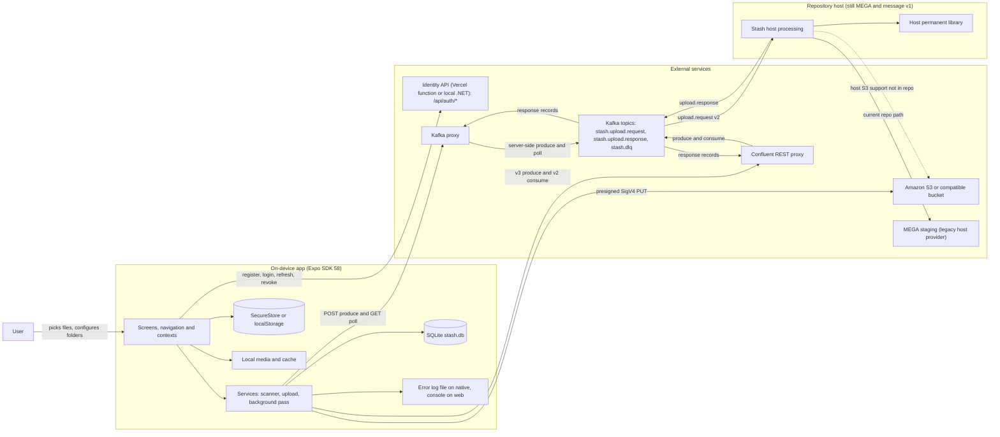
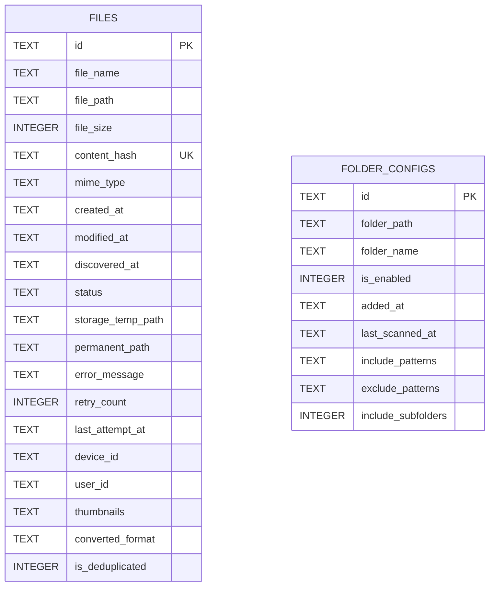
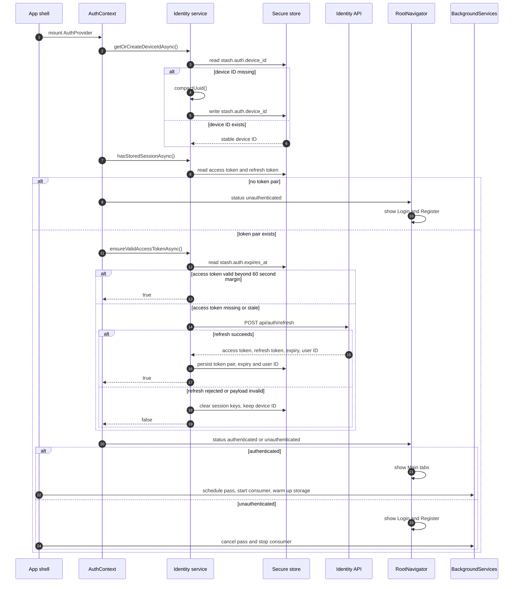
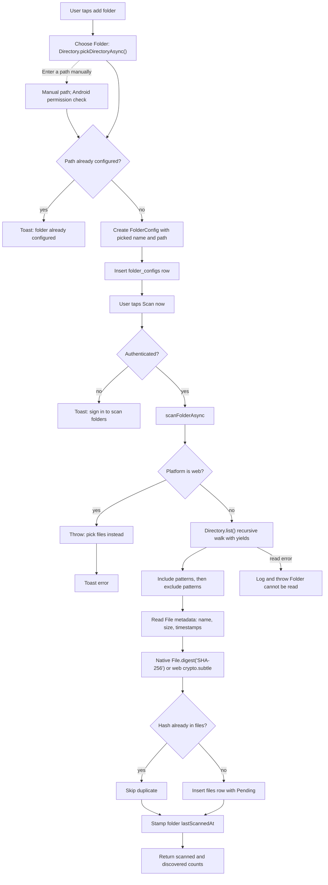
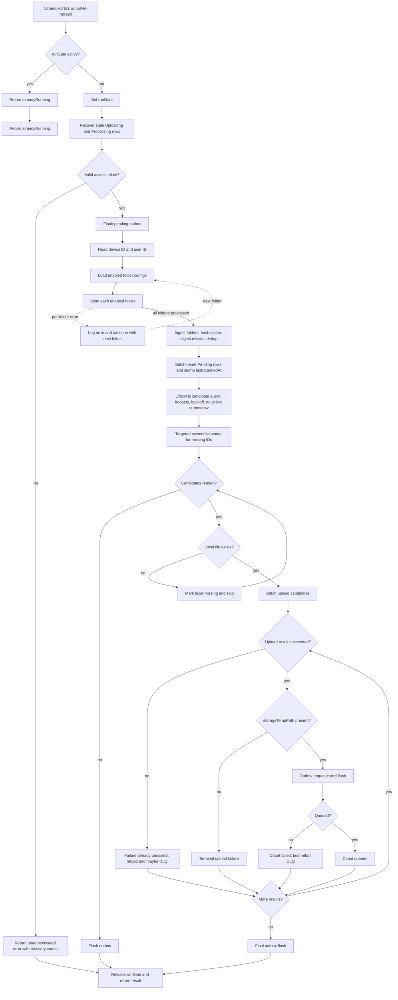
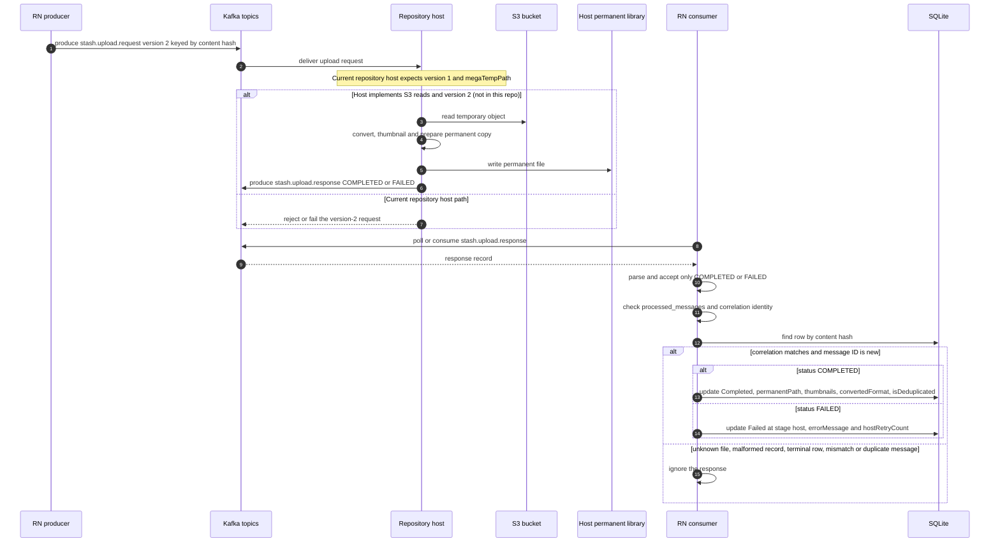
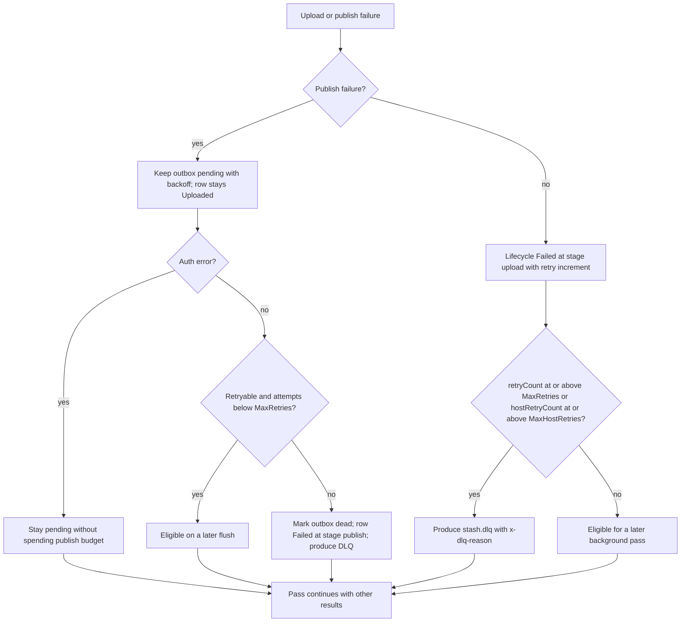
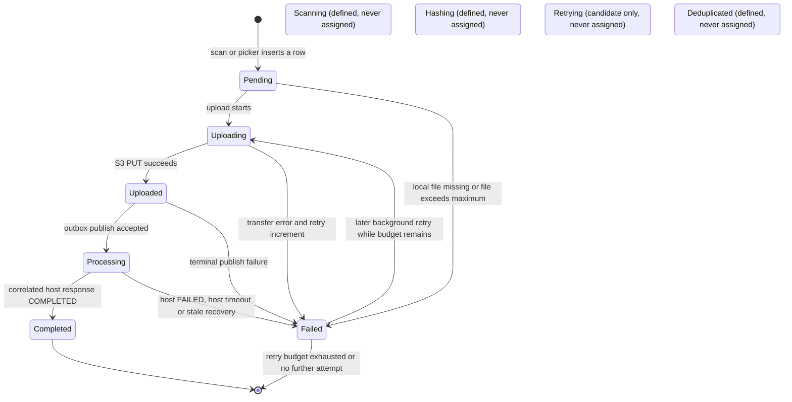
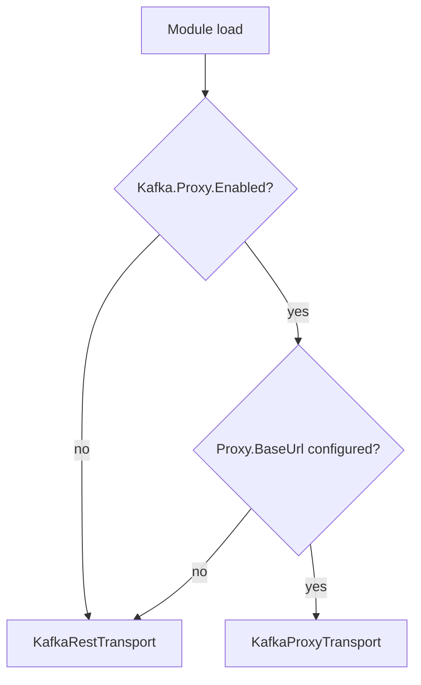

# Stash React Native Client: Architecture and Data Flow

**Status date:** 2026-11-21
**Scope:** the Expo/React Native client in `react_native_stash`. This document describes the runtime shell, local data, authentication, scanning, upload, background processing, S3 transfer, Kafka messaging and platform behavior as implemented in this repository. It is a client document: it does not claim that the repository host is ready for S3 or message version 2. The base app is Expo Go compatible on iOS/Android and runs on web. Folder scanning uses Expo SDK 58 `Directory.pickDirectoryAsync()` (Android SAF, iOS document picker) and `Directory.list()`; a manual path remains as an advanced fallback. iOS folder grants are session-scoped, and web cannot enumerate folders, so the browser is picker-only for uploads.

> **Implementation plan:** see **[IMPLEMENTATION_PLAN.md](IMPLEMENTATION_PLAN.md)** for the reliability, performance and observability plan and progress tracker.

> **Read this first - host compatibility gap.** The React Native app uploads temporary objects to S3 with presigned SigV4 `PUT` URLs and publishes `stash.upload.request` messages with `version: 2`, `storageTempPath` and `storageProvider: "S3"`. The host in this repository still stages through MEGA and uses a version-1 validator that expects `megaTempPath`. Until the host implements S3 reads and accepts version 2, the client can upload and publish, but the repository host cannot complete the processing loop. S3/v2 end-to-end processing is therefore a documented gap, not a verified path. The pre-Phase-1B presigner and the web bundle have been verified; the new signed payload-hash PUT, live S3 transfer and device testing are not claimed here.

---

## 1. System at a glance

The app is a local-first backup client. It discovers media, hashes it locally, deduplicates by SHA-256 in SQLite, uploads new bytes to S3 through short-lived presigned URLs, then asks the host to process the object through Kafka. Host responses come back through Kafka; the consumer applies status and permanent-library fields to the same SQLite row.

Text flow:

1. `index.ts` registers `App.tsx`. `App.tsx` loads fonts and mounts `SafeAreaProvider` -> `ThemeProvider` -> `AuthProvider` -> `ToastProvider` -> `Shell`.
2. `Shell` renders `RootNavigator`, a headless `BackgroundServices` component and `StatusBar`.
3. `AuthProvider` restores a session from SecureStore (localStorage on web) and decides whether the root stack shows Login/Register or Main.
4. Files enter the app in two ways: the Upload screen document picker, or the folder scanner walking configured folders on native platforms.
5. Every file is hashed with SHA-256. `files.content_hash` is `UNIQUE`, so a known hash is skipped rather than inserted.
6. `FileLifecycleService` is the only status writer. It applies guarded `Pending` -> `Uploading` -> `Uploaded` -> `Processing` -> `Completed`/`Failed` transitions, recovers stale rows and enforces the transfer/host retry budgets. `UploadManager` builds `/temp/uploads/{deviceId}/{contentHash}/{fileName}`, transfers bytes through the storage provider (S3) and mirrors accepted transitions in memory.
7. `uploadActions` or the background pass enqueues a version-2 request in the durable outbox; `OutboxPublisher` publishes it keyed by the content hash and moves the row to `Processing` only after Kafka accepts the record.
8. The host performs conversion, thumbnails and permanent storage. The app does not perform those steps.
9. The Kafka consumer reads `stash.upload.response`, finds the row by content hash, binds it to the recorded request correlation/message identity, deduplicates processed message IDs, and applies `Completed`/`Failed` plus `permanentPath`, `thumbnails`, `convertedFormat`, `isDeduplicated` and `errorMessage`.

```text
 User / Expo UI
      |
      +-- document picker ---------> local media / cache
      +-- folder scanner ----------> local media
      |
      v
 SHA-256 hash + SQLite dedup (stash.db, content_hash UNIQUE)
      |
      v
 UploadManager -- presigned SigV4 PUT --> S3 temporary object
      |
      v
 KafkaProducer -- stash.upload.request (v2, key=contentHash)
      |
      v
 Host (repository host is still MEGA/v1: S3/v2 is a gap)
      |
      +--> permanent library (when the host path works)
      |
      v
 stash.upload.response --> KafkaConsumer --> SQLite status + host fields
```

The important boundary is that the app never calls the host directly. It calls Identity API, S3 and a Kafka endpoint. The host is reached only through Kafka topics.

---

## 2. System context



Notes:

- The app talks to S3 directly; there is no upload bridge in the client path.
- Kafka proxy and Confluent REST proxy are alternative transports. The app selects one at startup.
- The host reads and writes Kafka. The dashed host-to-S3 edge is the missing repository capability.
- MEGA is shown only as the repository host's current staging provider. It is not the current React Native storage provider.
- The Identity API is the Vercel function in `kafka_proxy_vercel` (serving `/api/auth/*`) or the local .NET `StashHost.IdentityApi`. Tokens are HS256 with issuer `stash-auth` and audience `stash-app`; the Kafka proxy and any host still validating tokens must share the signing key.

---

## 3. Layered components

```mermaid
flowchart TB
    subgraph PresentationLayer["Presentation"]
        Entry["index.ts and App.tsx"]
        Shell["Shell: RootNavigator, BackgroundServices, StatusBar"]
        Screens["Login, Register, Files, Upload, Folders, Settings, About"]
        UIComponents["Buttons, inputs, text, dialogs, cards, rows, empty states, toasts"]
    end

    subgraph ContextLayer["Contexts"]
        AuthCtx["AuthContext"]
        ThemeCtx["ThemeContext"]
        ToastCtx["ToastContext"]
    end

    subgraph AppLayer["Application Services"]
        Wiring["singletons.ts"]
        AuthSvc["authenticationService.ts"]
        Scanner["folderScannerService.ts"]
        UploadMgr["uploadManager.ts"]
        UploadActions["uploadActions.ts"]
        BgService["backgroundUploadService.ts"]
        BgScheduler["backgroundUploadScheduler.ts"]
    end

    subgraph DataLayer["Data"]
        Database["database.ts"]
        FileRepo["fileRepository.ts"]
        FolderRepo["folderRepository.ts"]
        Models["models: file, folder, status, messages, media patterns"]
    end

    subgraph StorageLayer["Storage"]
        StorageIface["storageProvider.ts"]
        StorageFactory["storageProviderFactory.ts"]
        S3Service["s3StorageService.ts"]
        Signer["s3Signing.ts"]
        Transfer["s3Transfer.ts"]
    end

    subgraph KafkaLayer["Kafka"]
        TransportIface["kafkaTransport.ts"]
        Producer["kafkaProducer.ts"]
        Consumer["kafkaConsumer.ts"]
        ProxyTransport["kafkaProxyTransport.ts"]
        RestTransport["kafkaRestTransport.ts"]
    end

    subgraph PlatformLayer["Platform Adapters"]
        SecureStore["utils/storage.ts"]
        FileAccess["utils/fileAccess.ts"]
        ErrorLogger["utils/errorLogger.ts"]
        Permissions["utils/storagePermissions.ts"]
        IdHelpers["utils/id.ts and utils/base64.ts"]
        Format["utils/format.ts"]
    end

    subgraph ConfigLayer["Config"]
        RawConfig["appconfig.json"]
        TypedConfig["appConfig.ts"]
    end

    Entry --> Shell
    Shell --> Screens
    Screens --> UIComponents
    Screens --> AuthCtx
    Screens --> ThemeCtx
    Screens --> ToastCtx
    Screens --> Wiring
    AuthCtx --> AuthSvc
    ThemeCtx --> SecureStore
    ToastCtx --> ThemeCtx
    Wiring --> Scanner
    Wiring --> UploadMgr
    Wiring --> BgService
    Wiring --> BgScheduler
    Wiring --> Producer
    Wiring --> Consumer
    Wiring --> StorageFactory
    Wiring --> FileRepo
    Wiring --> FolderRepo
    UploadActions --> Scanner
    UploadActions --> UploadMgr
    UploadActions --> Producer
    UploadActions --> FileRepo
    UploadActions --> FolderRepo
    BgScheduler --> BgService
    BgService --> Scanner
    BgService --> UploadMgr
    BgService --> Producer
    BgService --> FileRepo
    BgService --> FolderRepo
    UploadMgr --> StorageIface
    UploadMgr --> FileRepo
    UploadMgr --> FileAccess
    StorageFactory --> S3Service
    S3Service --> StorageIface
    S3Service --> Signer
    S3Service --> Transfer
    Transfer --> FileAccess
    Producer --> TransportIface
    Consumer --> TransportIface
    Consumer --> FileRepo
    TransportIface --> ProxyTransport
    TransportIface --> RestTransport
    FileRepo --> Database
    FolderRepo --> Database
    FileRepo --> Models
    FolderRepo --> Models
    Scanner --> FileAccess
    Scanner --> ErrorLogger
    Scanner --> Models
    Producer --> AuthSvc
    Consumer --> AuthSvc
    AuthSvc --> SecureStore
    AuthSvc --> IdHelpers
    FileAccess --> ErrorLogger
    FileAccess --> Permissions
    Screens --> ErrorLogger
    Screens --> Permissions
    Screens --> Format
    RawConfig --> TypedConfig
    TypedConfig --> Wiring
    TypedConfig --> UploadMgr
    TypedConfig --> BgService
    TypedConfig --> BgScheduler
    TypedConfig --> S3Service
    TypedConfig --> ProxyTransport
    TypedConfig --> RestTransport
    TypedConfig --> AuthSvc
```



The diagram groups implementation files, not runtime processes. `Wiring` is the singleton module that constructs repositories, the storage provider, the upload manager, the Kafka transport, the producer/consumer and the background service.

---

## 4. Component inventory

| Layer | Component | Key files | Responsibility |
| --- | --- | --- | --- |
| Entry | Expo entry point | `index.ts` | Calls `registerRootComponent(App)`. |
| Runtime shell | App and Shell | `App.tsx` | Loads fonts, installs the global error handler, mounts SafeArea/Theme/Auth/Toast providers, and renders `Shell` inside `ErrorBoundary` (inside `ToastProvider`). |
| Runtime shell | BackgroundServices | `App.tsx` | Reacts to auth status: schedules the background pass, starts/stops the Kafka consumer and warms up storage. |
| Navigation | RootNavigator | `src/navigation/RootNavigator.tsx` | Shows a loading spinner, Login/Register when unauthenticated, Main when authenticated, and a header Log out action. |
| Navigation | MainTabs | `src/navigation/MainTabs.tsx` | Five tabs: Files, Upload, Folders, Settings, About. |
| Navigation | Route types | `src/navigation/types.ts` | `RootStackParamList` and `MainTabParamList`. |
| Screen | LoginScreen | `src/screens/LoginScreen.tsx` | Email/password/device ID sign-in, busy state, error text, link to Register. |
| Screen | RegisterScreen | `src/screens/RegisterScreen.tsx` | Registration with password match and 8-character validation, device ID, immediate session. |
| Screen | FilesScreen | `src/screens/FilesScreen.tsx` | Paginated file cards (50 per page, append on end reached), status chips, pull-to-refresh background pass, retry for Failed/Retrying, details dialog, Upload FAB. |
| Screen | UploadScreen | `src/screens/UploadScreen.tsx` | Document picker for `image/*` and `video/*`, oversize flags, hash/dedup/insert, batch upload and publish, toast summary. |
| Screen | FoldersScreen | `src/screens/FoldersScreen.tsx` | System folder picker, enable switch, Scan now, delete, folder actions; manual-path permission fallback on Android. |
| Screen | SettingsScreen | `src/screens/SettingsScreen.tsx` | Appearance mode, account IDs, log out, read-only config summary, an on-focus diagnostics health snapshot (status/stuck/outbox/hash-cache/processed counts, last pass/flush/response, recent `file_events`), storage permission controls and error log view/clear. |
| Screen | AboutScreen | `src/screens/AboutScreen.tsx` | App identity, palette and typography summary. |
| UI component | Shared primitives | `src/components/AppButton.tsx`, `FormInput.tsx`, `FormText.tsx`, `EmptyState.tsx` | MAUI-style buttons, inputs, headings/notes/errors and empty states. |
| UI component | Dialogs and rows | `src/components/ActionDialog.tsx`, `AddFolderDialog.tsx`, `FileCard.tsx`, `FolderRow.tsx` | Action sheets, system folder-picker dialog with manual path fallback, file cards and folder rows. |
| UI component | Error boundary | `src/components/ErrorBoundary.tsx` | Class error boundary around the shell; logs `react.errorBoundary` and shows a neutral "Something went wrong" / **Try again** fallback. |
| Context/provider | AuthProvider and useAuth | `src/auth/AuthContext.tsx` | Session restore, `status`, `userId`, `deviceId`, `login`, `register`, `logout`. |
| Context/provider | ThemeProvider and useTheme | `src/theme/ThemeContext.tsx` | System/light/dark resolution, palette selection, theme mode persistence. |
| Context/provider | ToastProvider and useToast | `src/components/ToastContext.tsx` | Animated snackbar-style feedback with optional error color. |
| Auth service | Identity API client | `src/auth/authenticationService.ts` | Register/login/refresh/revoke against the Identity API (Vercel function or local .NET) at `/api/auth/*`, token persistence, 30 s default timeout, 60 s expiry margin, device ID. |
| Auth model | Auth contracts | `src/models/authModels.ts` | Token pair, auth result, credentials/refresh/revoke request shapes, `expiresAt` parsing. |
| Data | SQLite database | `src/data/database.ts` | Opens `stash.db`, enables WAL and foreign keys, creates `files`, `folder_configs` and the Phase 0 delivery tables/indexes, singleton promise, ordered `PRAGMA user_version` migrations. |
| Data | FileRepository | `src/data/fileRepository.ts` | CRUD, lookup by id/content hash, existence checks, paginated reads (`getPageAsync`/`countAsync`), transactional batch inserts (`addManyAsync`), row-to-camelCase mapping, unique-hash error message. |
| Data | HashCacheRepository | `src/data/hashCacheRepository.ts` | `file_hash_cache` get/upsert/prune/clear keyed by URI, with size + modified time for cache validation. |
| Data | FolderRepository | `src/data/folderRepository.ts` | CRUD, lookup by id/path, JSON pattern parsing, camelCase mapping. |
| Data model | FileEntity | `src/models/fileEntity.ts` | Local file/upload state contract and `createFileEntity` defaults. |
| Data model | FolderConfig | `src/models/folderConfig.ts` | Folder configuration contract, path-derived name, default patterns. |
| Data model | UploadStatus | `src/models/uploadStatus.ts` | Status enum, display names, colors, icons and parsing. |
| Data model | Kafka messages | `src/models/messages.ts` | Upload request/response contracts, request factory, defensive response parser. |
| Data model | Media patterns | `src/models/mediaPatterns.ts` | Fourteen default include patterns and extension-to-MIME mapping. |
| Application service | Service wiring | `src/services/singletons.ts` | Constructs repositories, storage, upload manager, Kafka transport/producer/consumer, background service and scheduler. |
| Application service | FolderScannerService | `src/services/folderScannerService.ts` | Native `Directory.list()` recursive scan, include/exclude globs, MIME lookup, native `File.digest('SHA-256')`, cooperative yields, web rejection; emits `modifiedAtMs` for the hash cache. |
| Application service | FolderIngestionService | `src/services/folderIngestionService.ts` | Hash-cache validation, digest on misses, dedup, transactional batch inserts, `lastScannedAt` stamping and per-file hash error isolation. |
| Application service | FileLifecycleService | `src/services/fileLifecycleService.ts` | Guarded status transitions, stale recovery, host retry budget, response apply/dedup; the only status writer. |
| Application service | OutboxRepository | `src/data/outboxRepository.ts` | Durable publish intent, transactional enqueue/claim/sent/retry/dead state, sent-row pruning. |
| Application service | OutboxPublisher | `src/services/outboxPublisher.ts` | Enqueue+flush, per-row claim/publish, auth-aware retry, terminal publish failure and DLQ. |
| Application service | UploadManager | `src/services/uploadManager.ts` | Per-file and byte-aware batch transfer, content-hash path construction, in-progress guard, size checks; lifecycle transitions delegated to `FileLifecycleService`. |
| Application service | Upload actions | `src/services/uploadActions.ts` | Manual folder scan, single and batch upload, durable outbox enqueue, targeted ownership stamping. |
| Application service | BackgroundUploadService | `src/services/backgroundUploadService.ts` | Non-overlapping pass: stale recovery, auth, outbox flush, folder ingestion, lifecycle candidate selection, batch upload, outbox publish, dead letter. |
| Application service | BackgroundUploadScheduler | `src/services/backgroundUploadScheduler.ts` | AppState-aware `setInterval` scheduler, single timer, schedule/cancel. |
| Application service | Diagnostics service | `src/services/diagnosticsService.ts` | Read-only snapshot of file/outbox status counts, stuck rows, hash-cache/processed counts and recent `file_events`; degrades per-query when a table is unavailable. |
| Application service | Runtime state | `src/services/runtimeState.ts` | Process-local last background pass, last outbox flush and last Kafka response timestamps; resets on reload. |
| Kafka | Transport contract | `src/services/kafkaTransport.ts` | `KafkaTransport`, message/record shapes, transport exceptions. |
| Kafka | Producer | `src/services/kafkaProducer.ts` | Auth check, header construction, upload request/response and dead-letter production. |
| Kafka | Consumer | `src/services/kafkaConsumer.ts` | Consume upload responses, parse, filter statuses, correlate by request identity, dedup message IDs and apply through `FileLifecycleService`. |
| Kafka | Proxy transport | `src/services/kafkaProxyTransport.ts` | `POST /api/messages` produce, `GET /api/messages` polling, backoff, seen-record dedup; the proxy server filters polled records to the token device/user. |
| Kafka | REST transport | `src/services/kafkaRestTransport.ts` | Confluent REST Proxy v3 produce with cluster discovery/base64 fields, v2 consumer lifecycle. |
| Storage | Provider contract | `src/services/storage/storageProvider.ts` | `StorageProvider`, upload source shape, logical path semantics. |
| Storage | Provider factory | `src/services/storage/storageProviderFactory.ts` | Accepts S3 case-insensitively; rejects any other provider. |
| Storage | S3 service | `src/services/storage/s3StorageService.ts` | Config validation, path canonicalization, prefix mapping, presigned PUT/GET/HEAD/DELETE, payload-hash signing on upload, upload/exists/download/delete/size. |
| Storage | SigV4 signer | `src/services/storage/s3Signing.ts` | Pure-JS query-string presigner using `js-sha256`, host-only signing, optional signed SHA-256 payload hash (uploads) with `UNSIGNED-PAYLOAD` default. |
| Storage | S3 transfer | `src/services/storage/s3Transfer.ts` | SDK 58 `File.createUploadTask` streaming upload and legacy download; web Blob/fetch and object-URL download. |
| Platform adapter | Secure storage | `src/utils/storage.ts` | SecureStore on native, localStorage with memory fallback on web. |
| Platform adapter | File access | `src/utils/fileAccess.ts` | Platform-aware existence/size/read helpers, content URI staging with cache cleanup, web Blob reads. |
| Platform adapter | Error logger | `src/utils/errorLogger.ts` | Persistent native log, rotation, serialized writes, console mirror, global JS handler. |
| Platform adapter | Storage permissions | `src/utils/storagePermissions.ts` | Android 13+/12- permission selection for manual/legacy paths, partial-access detection, Expo Go detection, settings link. |
| Utility | IDs and Base64 | `src/utils/id.ts`, `src/utils/base64.ts` | UUID/compact UUID generation and UTF-8/Base64 helpers for REST produce/auth. |
| Utility | Formatting | `src/utils/format.ts` | File-size and date display helpers. |
| Config | Raw configuration | `src/config/appconfig.json` | Non-secret defaults for Kafka, S3, Identity API, upload settings, background pass and telemetry flag. |
| Config | Typed config and env overlay | `src/config/appConfig.ts` | `StashConfig` types, `EXPO_PUBLIC_*` overlay, URL helpers. |
| Theme | Palette and type | `src/theme/colors.ts`, `src/theme/typography.ts` | MAUI-derived light/dark palette, OpenSans family and layout sizes. |
| Build config | Expo metadata | `package.json`, `app.json`, `metro.config.js`, `.env.example` | Expo SDK 58 dependencies, app identity, Android permissions, web SQLite/WASM setup, documented environment variables. |

---

## 5. Local data model



Entity notes:

- `files` and `folder_configs` have no foreign keys. Folder-to-file association is implicit through the scanned path, not a relational link.
- `thumbnails` is a JSON object string (default `'{}'`). `include_patterns` and `exclude_patterns` are JSON array strings. The repositories parse JSON defensively and fall back to empty/default values.
- `files.status` is constrained by application code, not by a database CHECK constraint. `retry_count` defaults to 0; `is_deduplicated` is an integer boolean.
- `files.id` is a UUID generated on the device. The Kafka `fileId` and record key are not the UUID; they are `file.contentHash`, the lowercase SHA-256 hex digest.
- `content_hash` is `UNIQUE` and the repositories lower-case hash writes and lookups. Deduplication and consumer lookup are therefore by content hash, not by path or file name.
- Indexes exist on `files(status)`, `files(content_hash)`, `files(discovered_at)` and the composite `files(status, discovered_at)`. There is no index declared for folder paths or device/user columns.
- The schema is created through one promise in `src/data/database.ts`; a failed open resets the promise so a later call can retry. `PRAGMA journal_mode = WAL` is applied when the schema executes.
- The database also performs a one-time compatibility migration from the legacy `mega_temp_path` column to `storage_temp_path`. That migration is a local schema upgrade note; MEGA is not the current client storage provider.
- Schema upgrades run through an ordered `PRAGMA user_version` migration runner (version 1 is the `storage_temp_path` compatibility step). Version 2 adds the lifecycle timestamp/retry columns on `files` (`upload_started_at`, `processing_started_at`, `last_response_at`, `request_correlation_id`, `request_message_id`, `host_retry_count`, `next_attempt_at`, `failure_stage`, `updated_at`) and creates `outbox_messages`, `file_events`, `processed_messages` and `file_hash_cache`. Phase 1 writes outbox intents, lifecycle audit events and processed response IDs. Version 3 adds the pagination and scan indexes (`idx_files_discovered_at`, `idx_files_status_discovered`), and Phase 3 populates `file_hash_cache`. The ER diagram above shows only the original columns.
- TypeScript models and repositories use camelCase (`fileName`, `contentHash`, `lastScannedAt`); rows are mapped from snake_case columns at the repository boundary.

Storage locations:

| Data | Location | Notes |
| --- | --- | --- |
| Upload/folder rows | SQLite `stash.db` | App-managed database; WAL mode. |
| Access token, refresh token, expiry, user ID, device ID | SecureStore on native, localStorage on web, with memory fallback | Keys: `stash.auth.access_token`, `stash.auth.refresh_token`, `stash.auth.expires_at`, `stash.auth.user_id`, `stash.auth.device_id`. |
| Theme mode | Same secure/local storage adapter | Key `stash.theme.mode`. |
| Picked-file cache | Platform cache directory / `Paths.cache` | Document picker uses `copyToCacheDirectory`; `content://` uploads are copied to cache and removed in `finally`. |
| Error log | `<documents>/logs/stash-errors.log` on native | Rotated at 512 KiB, keeping roughly the last 256 KiB; web logs to the console only. |
| Device identity | `stash.auth.device_id` | Stable 32-hex compact UUID, preserved across logout. |

The device ID is an installation identifier, not an access credential. Logout removes the access/refresh/expiry/user keys but keeps the device ID.

---

## 6. Data flows

### 6.1 Startup and session restore

**Preconditions:** the app bundle is installed; `index.ts` is the entry; a session may or may not exist; the Identity API may be unavailable.

**Steps:**

1. `index.ts` registers `App`; `App.tsx` loads OpenSans and installs the global JS error logger.
2. Providers mount in order: `SafeAreaProvider` -> `ThemeProvider` -> `AuthProvider` -> `ToastProvider` -> `Shell`.
3. `AuthProvider` calls `getOrCreateDeviceIdAsync()`. It reads `stash.auth.device_id`; if missing, it creates a compact UUID and persists it.
4. `AuthProvider` checks for both an access token and a refresh token.
5. If a pair exists, `ensureValidAccessTokenAsync()` reads `expires_at`. A token with more than the 60-second margin remaining is accepted without a network call.
6. Otherwise the service calls `POST api/auth/refresh`. Success persists the new token pair, expiry and user ID. A rejected refresh or invalid payload clears the session keys, but not the device ID. A transport failure does not clear tokens.
7. `AuthProvider` sets `status` to `authenticated` or `unauthenticated`.
8. `RootNavigator` renders the loading spinner while `status` is `loading`, then Login/Register or Main.
9. When authenticated, `BackgroundServices` schedules the background pass, starts the Kafka consumer and calls `storageProvider.warmUpAsync()`. On logout or unmount it cancels the timer and stops the consumer.

**Writes:** `stash.auth.device_id` when created; access/refresh/expiry/user keys on login, register or refresh; session keys removed on logout or a dead refresh token.

**Failure paths:** missing or invalid stored session -> unauthenticated; refresh transport failure -> return false while preserving the stored pair; refresh rejection -> clear session; unexpected restore error -> log/console warning and unauthenticated; Identity API not configured -> refresh cannot succeed.



### 6.2 Add a folder and run a manual scan

**Preconditions:** manual Scan now requires an authenticated session; folder enumeration is native-only because web has no filesystem; iOS folder grants last for the current app session; Android system-picked folders use per-folder SAF grants, while manual paths may still require storage permissions.

**Steps:**

1. The user opens Folders, taps the add FAB, and taps Choose Folder. `AddFolderDialog` calls `Directory.pickDirectoryAsync()`; the selected `directory.uri` and `directory.name` are kept.
2. `FoldersScreen.onAdd` checks `folderRepository.getByPathAsync`. A duplicate path is rejected with a toast. For a manual non-`content://` Android path, the screen first calls `requestStorageAccessAsync()` and stops with an error when access is not granted.
3. A new `FolderConfig` is created with a UUID, the system-picked name (or `folderNameFromPath` for a manual path), enabled default, 14 default include patterns, empty excludes and `includeSubfolders: true`.
4. The row is inserted into `folder_configs`.
5. For Scan now, `scanFolderAsync(folder)` in `uploadActions` reads the device ID and user ID, then delegates to `FolderIngestionService.ingestFolderAsync`.
6. The scanner constructs `new Directory(folderPath)` and enumerates with `Directory.list()` recursively. It identifies directories with the `Directory` class (or a `list` method), applies include patterns then excludes against both the entry name and relative path, and yields to the event loop every 50 entries and at least once per directory.
7. `ScannedFile` entries carry `uri`, `name`, `size`, `createdAt` from `creationTime`, `modifiedAt` from `lastModified`, and the raw `modifiedAtMs` used as a hash-cache key. MIME is resolved later in the ingestion layer. `scanFolderAsyncWithPatterns` exposes the same walk with explicit patterns.
8. For each entry the ingestion service checks `file_hash_cache` by URI + size + modified time. A hit with the same size and `modifiedAt` reuses the cached hash and skips the digest. A miss computes SHA-256 (native `File.digest('SHA-256')`; a `content://` fallback copies to `Paths.cache`, digests, deletes in `finally`; web uses `crypto.subtle` with a `js-sha256` fallback) and writes the cache entry.
9. Existing hashes are skipped. New hashes are collected and flushed through `FileRepository.addManyAsync` in transactional batches of 25; `INSERT OR IGNORE` keeps duplicate hashes out.
10. `folder.lastScannedAt` is stamped once and persisted; cache entries older than 30 days are pruned at the start and end of ingestion.

**Writes:** a `folder_configs` row; transactional `files` batches for new hashes; `last_scanned_at` after scanning; `file_hash_cache` entries for hashes computed on a miss; a temporary cache copy only when the `content://` digest fallback runs.

**Failure paths:** web scan throws "Folder scanning is not available in the browser"; unreadable directories are logged and throw `Folder cannot be read: <uri> (<message>)`, so an expired iOS session grant is visible in the UI; manual Android paths surface permission denials; hash errors are logged and the file is skipped; duplicate hashes are skipped; duplicate folder paths are rejected; a failed folder update surfaces through the screen toast. The manual scan does not upload or publish; it only discovers rows.



### 6.3 Manual pick, hash, dedup, batch upload and publish

**Preconditions:** the user is on Upload; an authenticated session is required to upload; S3 is configured; a Kafka transport is configured; the file is not larger than `UploadSettings.MaxFileSizeBytes`.

**Steps:**

1. The user taps Pick Files. `expo-document-picker` opens for `image/*` and `video/*`, allows multiple selection, and copies assets to the cache directory.
2. Picked assets are appended to the screen list, de-duplicated by URI/name/size within the selection. Files above the 500 MB default are flagged in the list.
3. The user taps Upload Files. The screen hashes each picked file and checks `existsByContentHashAsync`.
4. New files are inserted as `Pending`. Duplicates and hash failures are counted but not inserted.
5. `uploadBatchAndPublishAsync` verifies the access token, reads device/user IDs, and fills missing IDs with the targeted `FileRepository.setOwnershipAsync` update (no whole-row write).
6. `UploadManager.uploadBatchAsync` processes the list in byte-aware batches: at most `BatchSize` transfers (10 default) and at most `MaxConcurrentBytes` (256 MB default) declared file bytes per batch, with `Promise.all` per batch. A single file larger than the byte budget runs alone; a byte budget at or below 0 means unlimited.
7. For each file, `UploadManager` checks local existence, fills a missing size, enforces the maximum size, calls `FileLifecycleService.markUploadingAsync` (guarded), then builds `/temp/uploads/{deviceId}/{contentHash}/{fileName}`. A rejected transition returns a failure without throwing.
8. `S3StorageService` canonicalizes the path, then HEADs the key: because the logical path contains the content hash, an existing object already holds the same bytes and is reused without a PUT. HEAD errors (permissions, network) are ignored and the upload continues. Otherwise it applies the optional prefix, signs the `PUT` (including the file's SHA-256 payload hash when known), and transfers the bytes. Native uses SDK 58 `File.createUploadTask` with progress, cancellation and a size-aware timeout; web reads the file, sends a Blob and aborts on timeout/cancel.
9. Success calls `FileLifecycleService.markUploadedAsync`, which writes `Uploaded` and the canonical `storageTempPath`. A concurrent state change is reported as a failure, not overwritten.
10. `uploadActions` calls `OutboxPublisher.enqueueAndFlushAsync`. The outbox row, request identity and `publish_queued` event are committed together; a successful Kafka publish marks the outbox sent and moves the row to `Processing` when that transition is still legal.
11. A toast reports uploaded, queued, failed and duplicate counts.

**Writes:** guarded `files` transitions at `Pending`, `Uploading`, `Uploaded`, `Processing` or `Failed`; `storage_temp_path`, `error_message`, `last_attempt_at`, `retry_count`, device/user IDs; `outbox_messages` and `file_events`; the S3 temporary object.

**Failure paths:** hash failure -> not inserted; duplicate -> skipped; local file missing -> `Failed` at stage `local`, no retry increment; oversize -> terminal `Failed` at stage `local`; transfer failure -> `Failed` at stage `upload`, retry incremented; missing temporary path after upload -> terminal `Failed` at stage `upload`; publish failure -> the row stays `Uploaded`, the outbox keeps the intent pending with backoff, and terminal publish failure marks the row `Failed` and dead-letters; unauthenticated batch -> all files reported failed. The temporary S3 object is not deleted by the client on a publish failure.

```mermaid
sequenceDiagram
    autonumber
    participant U as User
    participant Up as UploadScreen
    participant Sc as FolderScanner
    participant DB as FileRepository
    participant Ac as uploadActions
    participant UM as UploadManager
    participant SS as S3StorageService
    participant TR as s3Transfer
    participant SG as s3Signing
    participant S3 as S3
    participant LC as FileLifecycleService
    participant OP as OutboxPublisher
    participant KP as KafkaProducer
    participant KT as KafkaTransport

    U->>Up: Pick image and video files
    Up->>Up: append assets from document picker
    Up->>Up: flag files above the configured maximum
    loop each picked file
        Up->>Sc: computeFileHashAsync(uri, size)
        Sc-->>Up: lowercase SHA-256 hex
        Up->>DB: existsByContentHashAsync(hash)
        alt hash exists
            Up->>Up: count duplicate and skip
        else new hash
            Up->>DB: addAsync with Pending
        end
    end
    Up->>Ac: uploadBatchAndPublishAsync(new entities)
    Ac->>Ac: ensureValidAccessTokenAsync()
    alt not authenticated
        Ac-->>Up: all failed
    else authenticated
        Ac->>DB: setOwnershipAsync (targeted)
        Ac->>UM: uploadBatchAsync(files)
        loop each byte-aware batch
            loop each file in the batch
                UM->>UM: check local file, size and maximum
                UM->>LC: markUploadingAsync(id, path)
                UM->>SS: uploadFileAsync(source, logicalPath)
                SS->>SG: presign PUT with payload hash
                SG-->>SS: presigned URL
                SS->>TR: putFileToPresignedUrlAsync(url, source)
                TR->>S3: PUT file bytes
                S3-->>TR: 2xx
                TR-->>SS: transfer complete
                UM->>LC: markUploadedAsync(id, uploadedPath)
            end
        end
        loop each uploaded file
            Ac->>OP: enqueueAndFlushAsync(file, deviceId, userId)
            OP->>DB: outbox insert + identity + publish_queued
            OP->>KP: produceUploadRequestAsync(message)
            KP->>KT: produce stash.upload.request keyed by contentHash
            KT-->>KP: accepted
            OP->>DB: mark sent + Processing (guarded)
        end
    end
    Up->>U: show toast summary
    Note over UM,DB: Transfer failure marks Failed at stage upload and increments retry. Publish failure leaves the row Uploaded; the outbox retries, then dead-letters and marks terminal failure.
```

### 6.4 Background upload pass

**Preconditions:** an authenticated session; `BackgroundUpload.Enabled`; for the timer, the app must be `active`; at least one enabled folder or eligible local row; storage and Kafka configured for the phases that need them.

**Steps:**

1. The scheduler's `setInterval` fires every `BackgroundUpload.IntervalMinutes` (15 default), but only while enabled and `AppState.currentState === 'active'`. Pull-to-refresh on Files calls the same service directly.
2. `runOnceAsync` checks `runGate`. If a pass is already running, it returns `alreadyRunning` without doing work.
3. Before auth, the pass calls `FileLifecycleService.recoverStaleAsync({ maxRetries, maxHostRetries })`. Stale `Uploading` rows become `Failed` at stage `upload` with a retry increment; stale `Processing` rows become `Failed` at stage `host_timeout` with a host-retry increment. The result reports `recoveredUploads` and `recoveredProcessing`.
4. The service calls `ensureValidAccessTokenAsync`; failure returns an unauthenticated error (recovery counts are still included).
5. After auth it flushes the outbox, sending any due pending requests before scanning.
6. It reads the device ID and user ID, loads all folder configs, and keeps enabled folders.
7. Each enabled folder is scanned and ingested through `FolderIngestionService.ingestFolderAsync`. Scan errors are logged per folder and the pass continues with the next folder.
8. Unchanged files skip hashing through the URI + size + modified-time hash cache; new hashes are deduplicated, inserted as `Pending` in transactional batches, and `lastScannedAt` is stamped.
9. Candidate selection is delegated to `FileLifecycleService.getCandidatesAsync(maxFiles, maxRetries, maxHostRetries)`: `Pending`, `Retrying`, `Uploaded`, or `Failed` rows inside both retry budgets, due by `next_attempt_at`, with no active outbox row, and not already publish-terminal (`failure_stage = 'publish'`; only a manual retry re-enqueues those). The list is capped at `MaxFilesPerRun` (50 default; a value at or below 0 means unlimited). Local-terminal rows are ordered last so they cannot consume the whole window. A candidate whose local file no longer exists is marked `Failed` at stage `local` and skipped.
10. Missing device/user IDs are filled with the targeted `FileRepository.setOwnershipAsync` update.
11. The candidate list is uploaded through `UploadManager.uploadBatchAsync`, which applies `BatchSize` and `MaxConcurrentBytes` limits per batch and its own in-progress guard.
12. Upload failures were already marked `Failed` at stage `upload` by `UploadManager`. The pass increments `failed`, reloads the fresh row and may dead-letter it when either retry budget is exhausted.
13. A successful upload without `storageTempPath` is marked terminal at stage `upload` and counted as failed.
14. A successful upload increments `uploaded` and calls `OutboxPublisher.enqueueAndFlushAsync`. A queued intent increments `queued`; a failure to queue increments `failed` and best-effort dead-letters the fresh row.
15. The pass flushes the outbox once more at the end (and before returning when there are no candidates), so requests persisted by this pass are attempted even if the per-file flush was gated.
16. `runGate` is released in `finally`; the result reports scanned, discovered, uploaded, queued, failed and the two recovery counts.
**Writes:** new `files` rows; `folder_configs.last_scanned_at`; guarded status/error/retry/timestamp/device/user fields; `outbox_messages` and `file_events`; Kafka upload requests; Kafka dead letters.

**Failure paths:** unauthenticated -> no work; overlapping call -> skipped; per-folder scan failure -> logged and continue; missing local file -> marked local-missing and skipped; missing storage path after upload -> terminal upload failure; publish failure -> intent stays in the outbox, terminal publish failure marks the row failed and dead-letters; dead-letter production is best effort and never blocks the pass.



### 6.5 Host processing, response and consumer update

**Preconditions:** a version-2 request was published; the host is consuming `stash.upload.request`; the host supports S3 and version 2; the app's consumer is running for `stash.upload.response`.

**Steps:**

1. The app produces a version-2 request keyed by content hash. The request names `storageTempPath` and `storageProvider: "S3"`.
2. The host consumes the request through its Kafka trigger. In the repository as it stands, the host's validator expects version 1 and `megaTempPath`, so the S3/v2 request is rejected. This is the compatibility gap.
3. In a host with S3/v2 support, the host would read the temporary S3 object, perform conversion and thumbnails, write a permanent copy, and produce `stash.upload.response`.
4. The app's consumer reads the response topic under group `stash-mobile-{deviceId}`.
5. It parses the response defensively, ignores malformed records, and applies only `COMPLETED` and `FAILED`.
6. It looks up the local row by `response.fileId` through `content_hash`.
7. It ignores a `messageId` already present in `processed_messages` (durable dedup), then compares `correlationId` with the file's `request_correlation_id` when both are present; a mismatch is ignored.
8. On `COMPLETED`, `FileLifecycleService` writes `Completed`, `permanentPath`, `thumbnails`, `convertedFormat`, `isDeduplicated` and `lastResponseAt`, records the processed message ID and appends a `file_events` audit row.
9. On `FAILED`, it writes `Failed` at stage `host`, increments `host_retry_count`, applies the response fields, stores `errorMessage`, stamps `lastResponseAt` and records idempotency/audit rows.
10. Unknown files, terminal rows, unsupported statuses and duplicate/stale responses are ignored with a console message; they are not inserted or re-applied.

**Writes:** guarded `files` fields (`status`, `permanent_path`, `thumbnails`, `converted_format`, `is_deduplicated`, `error_message`, `last_response_at`, `host_retry_count`, `next_attempt_at`, `processing_started_at`); `processed_messages`; `file_events`.

**Failure paths:** host does not support v2/S3 -> no successful response; host processing error -> `FAILED` response if the host produces one; malformed response -> ignored; unknown content hash -> ignored; unsupported status -> ignored; identity or correlation mismatch, duplicate message ID and already-terminal rows -> ignored; repository update failure -> caught and logged by the consumer. Proxy-side filtering is implemented; ACK/commit-after-apply and server-side response routing remain blocked.



### 6.6 Retry and dead-letter flow

**Preconditions:** `UploadSettings.MaxRetries` (3 default) and `MaxHostRetries` (3 default); `stash.dlq` configured; the failure happens in an upload or publish path.

**Steps:**

1. A transfer failure calls `FileLifecycleService.markUploadFailedAsync`: the row becomes `Failed` at stage `upload`, `retry_count` increments, and `next_attempt_at` gets backoff. Local-missing and oversize failures do not increment retry.
2. A publish failure in the manual or background path leaves the file row `Uploaded`. The outbox row stays `pending` with `last_error` and `next_attempt_at`; neither `uploadActions` nor `BackgroundUploadService` rewrites status or retry counters for a publish error.
3. Auth failures keep the outbox row pending without consuming the publish retry budget, so a token refresh can recover it.
4. Retryable transport errors keep retrying while the claimed attempt count is below `MaxRetries`. A non-retryable error, or an exhausted attempt count, marks the outbox row `dead`, calls `lifecycle.markTerminalFailureAsync(fileId, 'publish', error)` and produces a dead letter with the original request payload.
5. For upload/host budget exhaustion, the background pass produces a dead letter when `status === Failed` and either `retry_count >= MaxRetries` or `host_retry_count >= MaxHostRetries`.
6. The dead-letter payload includes `fileId` (content hash), `fileName`, `filePath`, `fileSize`, `error`, `retryCount`, `hostRetryCount`, `failureStage`, `lastResponseAt`, `lastAttemptAt`, `deviceId`, `userId` and `timestamp`.
7. If the budget is not exhausted, a `Failed` row remains eligible for a later background pass; an outbox row with backoff is retried by the next flush.
8. The manual and background publish paths now both reach the DLQ through `OutboxPublisher`; the previous "no manual DLQ call site" gap is closed.

**Writes:** guarded `retry_count`, `status`, `failure_stage`, `error_message`, `next_attempt_at`, `last_response_at`; outbox `status`, `attempts`, `next_attempt_at`, `last_error`, `sent_at`; `file_events`; a `stash.dlq` record when produced.

**Failure paths:** local-missing and oversize do not increment retry; local-terminal failures are excluded from automatic retries until a manual retry; dead-letter production is best effort and may itself fail; a `Failed` row at or above either budget is no longer an upload candidate; publish-terminal rows are also excluded until a manual retry; local-terminal and publish-terminal rows are excluded from automatic candidates until a manual retry; stale recovery can consume the transfer or host budget.



---

## 7. Upload status state machine

The enum defines ten statuses. The current core flow writes `Pending`, `Uploading`, `Uploaded`, `Processing`, `Completed` and `Failed`. `Retrying` is recognized as a background candidate but is not assigned by current code. `Scanning`, `Hashing` and `Deduplicated` are defined for contract/UI parity and are not assigned by current code.

**Lifecycle ownership:** `FileLifecycleService` is the single writer of `files.status`. Upload transitions are guarded (`Pending`/`Retrying`/`Failed`/`Uploaded` -> `Uploading` -> `Uploaded`), publish transitions require an outbox send while the row is `Uploaded`/`Failed`, and response application requires a matching correlation identity and a new message ID. `recoverStaleAsync` turns `Uploading`/`Processing` rows older than the stale threshold into `Failed` outcomes with retry/host counts, so a crash or a lost host response cannot leave a row in flight indefinitely.



Retry table:

| Trigger | Counter change | Resulting status | Dead-letter behavior |
| --- | --- | --- | --- |
| Upload transfer error or storage exception | `retry_count + 1` | `Failed` | Background pass checks budget and may produce `stash.dlq`. |
| Local file missing before transfer | No increment | `Failed` | Not a background candidate while the local file is absent; no DLQ from this path. |
| File exceeds `MaxFileSizeBytes` | No increment | `Failed` | Terminal `Failed` at stage `local`; excluded from automatic candidates until a manual retry. Retry count stays unchanged, so it never reaches the DLQ threshold automatically. |
| Publish error in manual or background upload | No immediate file counter; outbox `attempts` increments per flush | Stays `Uploaded`, then `Failed` with stage `publish` on terminal publish failure | Outbox retries with backoff; terminal failure marks stage `publish`, produces `stash.dlq` and excludes the row from automatic candidates. |
| Publish auth error | No file or outbox attempt budget consumed | Unchanged | Outbox stays pending for a token refresh. |
| Host `FAILED` response | `host_retry_count + 1` | `Failed` | Background pass DLQs when `host_retry_count >= MaxHostRetries`. |
| Stale `Uploading`/`Processing` recovery | `retry_count + 1` or `host_retry_count + 1` | `Failed` at `upload`/`host_timeout` | Recovery does not itself DLQ; an exhausted recovered row is excluded from candidates until a manual retry (residual gap). |
| Upload succeeds without a temporary path | No retry increment | `Failed` at stage `upload` | Counted as failed; DLQ only when a budget is already exhausted. |

`MaxRetries` bounds transfer attempts and outbox publish attempts; `MaxHostRetries` bounds host processing attempts. The background pass produces a dead letter when a `Failed` row has exhausted either budget. Local-missing and oversize failures do not increment either counter; local-terminal and publish-terminal failures are excluded from automatic candidates until a manual retry.

---

## 8. S3 provider internals

`Storage.Provider` must be `S3`; the factory accepts it case-insensitively and throws for anything else. The provider contract is logical-path based: callers use leading-slash paths such as `/temp/uploads/{deviceId}/{contentHash}/{fileName}`, and the S3 service maps them to bucket keys.

### 8.1 Path and key mapping

The S3 service canonicalizes paths before signing:

- backslashes become forward slashes;
- empty segments and `.` segments are removed;
- `..` is rejected;
- the result always has one leading slash and no trailing slash;
- an empty result is rejected.

The key is the optional prefix (leading/trailing slashes trimmed) plus the path without its leading slash.

| Logical path | `Storage.S3.Prefix` | Bucket key |
| --- | --- | --- |
| `/temp/uploads/dev/<contentHash>/IMG.jpg` | empty | `temp/uploads/dev/<contentHash>/IMG.jpg` |
| `/temp/uploads/dev/<contentHash>/IMG.jpg` | `stash` | `stash/temp/uploads/dev/<contentHash>/IMG.jpg` |
| `/temp/uploads/dev/<contentHash>/IMG.jpg` | `stash/` | `stash/temp/uploads/dev/<contentHash>/IMG.jpg` |

Addressing:

- `ForcePathStyle: false` (default) uses virtual-hosted addressing: the host is `{bucket}.{endpoint-host}` and the canonical URI is the key path.
- `ForcePathStyle: true` uses path-style addressing: the bucket is part of the path, which is required by MinIO and many S3-compatible servers.
- An empty `Endpoint` uses the AWS endpoint form `https://s3.{region}.amazonaws.com`. A custom endpoint must start with `http://` or `https://` and may include a path prefix.

### 8.2 Presigning steps

1. Validate bucket, region, access key and secret key. `warmUpAsync` does this at startup and logs failures without throwing.
2. Canonicalize the logical path and build the key with the optional prefix.
3. Choose AWS or the custom endpoint and choose virtual-hosted or path-style addressing.
4. Format the date as `yyyyMMddTHHmmssZ` and build the credential scope `{date}/{region}/s3/aws4_request`.
5. Build sorted, RFC3986-encoded query parameters: `X-Amz-Algorithm`, `X-Amz-Credential`, `X-Amz-Date`, `X-Amz-Expires`, `X-Amz-SignedHeaders=host`, plus `X-Amz-Security-Token` when a session token exists.
6. Build the canonical request with only the `host` signed header. `PUT` uploads pass the file's lowercase SHA-256 as the canonical payload hash when it is known; GET/HEAD/DELETE and hashless uploads use `UNSIGNED-PAYLOAD`.
7. Derive the signing key through the HMAC chain and append `X-Amz-Signature`.
8. Clamp the expiry to 1...604800 seconds. The configured default is 3600 seconds.

The signer is pure JavaScript: `js-sha256` provides SHA-256 and HMAC. There is no WebCrypto, Node `crypto`, `Buffer`, stream or AWS SDK dependency.

Signing the payload hash binds the presigned URL to the bytes the app hashed locally. If the file changes between hashing and transfer, S3 rejects the PUT instead of storing content that no longer matches `files.content_hash`. The hash is validated as 64 hexadecimal characters before it is used.

### 8.3 Native and web transfer matrix

| Concern | Native iOS/Android | Web |
| --- | --- | --- |
| Upload API | SDK 58 `File.createUploadTask` with `PUT` + `BINARY_CONTENT` + `FOREGROUND` | `readFileBytesAsync` -> `Uint8Array` -> `Blob` -> `fetch` PUT |
| Upload memory behavior | File is streamed by native code; not buffered in JS | Whole selected file is read into memory |
| Upload headers | `Content-Type` from the file MIME type | `Content-Type` from the file MIME type |
| Upload timeout/cancel | Combined caller signal + timeout (30 min default, or 5 min...2 h sized from file size); progress via `onProgress` | Combined caller signal + timeout with `AbortController`; progress not reported |
| `content://` source | Copied to `Paths.cache` first, then uploaded; temporary copy deleted in `finally` | Not applicable |
| Download | `downloadAsync` to a destination file; partial file deleted on failure | `fetch` -> `Blob` -> object URL -> browser download anchor |
| Folder scanning | System folder picker + `Directory.list()` | Rejected; use the document picker |
| Local persistence | SecureStore, SQLite, native error log | localStorage with memory fallback, SQLite web support via Metro WASM/COOP/COEP config, console-only logs |
| S3 CORS | Not applicable for native requests | Required for direct browser PUT/GET/HEAD calls |

### 8.4 Provider methods: current use and parity

The interface also exposes the read-only `name` property (`S3`).

| Method | Behavior | Current UI call site |
| --- | --- | --- |
| `uploadFileAsync` | Canonicalizes the path, HEADs it first and reuses an existing object (same content hash), otherwise presigns `PUT` (signing the content hash when present), transfers with timeout/cancel support, and returns the canonical logical path; rejects size 0 | Used by `UploadManager` for every upload. |
| `warmUpAsync` | Validates configuration and logs bucket/region/endpoint/path-style without throwing | Called by `BackgroundServices` when authenticated. |
| `existsAsync` | Presigns `HEAD`; 200/204 true, 404 false, other status error | No current UI call site; provider parity. |
| `downloadAsync` | Presigns `GET`; native writes to a destination, web downloads via object URL | No current UI call site; provider parity. |
| `deleteFileAsync` | Presigns `DELETE`; 200/204 true, 404 false, other status error | No current UI call site; provider parity. |
| `getFileSizeAsync` | Presigns `HEAD` and reads `content-length`; null when unavailable | No current UI call site; provider parity. |

### 8.5 Configuration

| Setting | Default | Environment override | Meaning |
| --- | --- | --- | --- |
| `Storage.Provider` | `S3` | none | Provider label; only S3 is supported. |
| `Storage.S3.Bucket` | empty | `EXPO_PUBLIC_S3_BUCKET` | Target bucket; empty fails upload with a configuration error. |
| `Storage.S3.Region` | `us-east-1` | `EXPO_PUBLIC_S3_REGION` | Region in the credential scope and AWS endpoint. |
| `Storage.S3.AccessKeyId` | empty | `EXPO_PUBLIC_S3_ACCESS_KEY_ID` | Access key used to sign. |
| `Storage.S3.SecretAccessKey` | empty | `EXPO_PUBLIC_S3_SECRET_ACCESS_KEY` | Secret key used to sign. |
| `Storage.S3.SessionToken` | empty | `EXPO_PUBLIC_S3_SESSION_TOKEN` | Optional session token sent as `X-Amz-Security-Token`. |
| `Storage.S3.Endpoint` | empty (AWS) | `EXPO_PUBLIC_S3_ENDPOINT` | Custom S3-compatible endpoint. |
| `Storage.S3.ForcePathStyle` | `false` | `EXPO_PUBLIC_S3_FORCE_PATH_STYLE` | Path-style addressing for MinIO and similar servers. |
| `Storage.S3.Prefix` | empty | `EXPO_PUBLIC_S3_PREFIX` | Optional key prefix without leading/trailing slash. |
| `Storage.S3.PresignExpirySeconds` | `3600` | `EXPO_PUBLIC_S3_PRESIGN_EXPIRY_SECONDS` | URL lifetime, clamped to 1...604800. |

### 8.6 Security and CORS caveats

- S3 credentials are inlined into the client bundle through `EXPO_PUBLIC_*` values. Use scoped credentials and rotate anything exposed.
- A presigned URL is a bearer credential for its method, key and lifetime. Do not log it. The S3 service and transfer module redact `X-Amz-Signature` and `X-Amz-Security-Token` from logged errors.
- Web transfers call S3 from the browser. The bucket needs CORS rules for the Expo origin and the methods in use. The client's current UI path uses `PUT`; provider parity methods use `GET`, `HEAD` and `DELETE`.
- A single presigned `PUT` is an S3 single-object operation and is subject to S3's 5 GB single-upload limit. Multipart/resumable upload is not implemented (deferred; see the implementation plan register). The app's 500 MB default maximum keeps normal uploads below that limit.
- Signed payload hashes provide integrity against a changed local file; they are not a confidentiality control and do not replace TLS.
- Presigned URLs expire. A long-running retry after expiry requires a new URL; the provider signs at the time of the call.
- Custom endpoints that use `http://` transmit without TLS. Prefer `https://` outside local development.

---

## 9. Kafka contract

### 9.1 Topics

| Topic | Direction for the app | Purpose |
| --- | --- | --- |
| `stash.upload.request` | Produce | Ask the host to process an uploaded temporary object. |
| `stash.upload.response` | Consume | Receive host completion/failure and permanent-library fields. |
| `stash.dlq` | Produce | Record files whose retries are exhausted in the background pass. |

Topic names come from `appconfig.json` (`Kafka.TopicUploadRequest`, `Kafka.TopicUploadResponse`, `Kafka.TopicDeadLetter`).

### 9.2 Upload request (version 2)

The values below are illustrative; the field names and types are the contract.

```json
{
  "messageId": "9a7b1c2d-3e4f-4a5b-8c9d-0e1f2a3b4c5d",
  "timestamp": "2026-11-21T00:00:00.000Z",
  "fileId": "0123456789abcdef0123456789abcdef0123456789abcdef0123456789abcdef",
  "fileName": "IMG_0001.jpg",
  "fileSize": 4827133,
  "mimeType": "image/jpeg",
  "storageTempPath": "/temp/uploads/<deviceId>/<contentHash>/IMG_0001.jpg",
  "storageProvider": "S3",
  "metadata": {
    "createdAt": "2026-11-20T12:00:00.000Z",
    "modifiedAt": "2026-11-20T12:00:00.000Z"
  },
  "deviceId": "0123456789abcdef0123456789abcdef",
  "userId": "user-123",
  "correlationId": "2b3c4d5e-6f70-4819-a2b3-c4d5e6f70819",
  "version": 2
}
```

Contract notes:

- `fileId` is the SHA-256 content hash, not the SQLite UUID. The Kafka record key is the same value.
- `storageTempPath` is the canonical logical path returned by the storage provider, for example `/temp/uploads/{deviceId}/{contentHash}/{fileName}`. The content-hash segment lets repeated uploads reuse an existing object through HEAD.
- `storageProvider` is the configured provider label; the only supported value is `S3`.
- `metadata.createdAt` and `metadata.modifiedAt` come from the local row.
- `messageId` and `correlationId` are UUIDs generated for the request.

### 9.3 Upload response

```json
{
  "messageId": "5e6f7081-92a3-4b4c-8d9e-0f1a2b3c4d5e",
  "timestamp": "2026-11-21T00:00:10.000Z",
  "fileId": "0123456789abcdef0123456789abcdef0123456789abcdef0123456789abcdef",
  "status": "COMPLETED",
  "permanentPath": "<host-returned-permanent-path>",
  "thumbnails": {
    "small": "<host-returned-thumbnail-path>"
  },
  "convertedFormat": "jpg",
  "deduplicated": false,
  "processingTimeMs": 8421,
  "error": null,
  "deviceId": "0123456789abcdef0123456789abcdef",
  "userId": "user-123",
  "correlationId": "2b3c4d5e-6f70-4819-a2b3-c4d5e6f70819",
  "version": 1
}
```

The consumer only applies `COMPLETED` and `FAILED`. It ignores malformed JSON, records without a non-empty `fileId`, unknown content hashes, unsupported statuses and already-terminal rows. It also ignores a `messageId` already recorded in `processed_messages` and a `correlationId` that conflicts with the file's recorded request correlation. Response `deviceId`/`userId` are optional for legacy/direct-REST compatibility, but when both the response and the local row carry a non-empty value and they differ, `FileLifecycleService` returns `mismatch` and does not apply the response. Matching responses are applied through `FileLifecycleService`, which guards the status transition. `thumbnails` is applied as returned; the consumer does not synthesize it.

The Vercel Kafka proxy filters polled records to the token's verified device and user before returning them; records with a different `deviceId`, a conflicting `userId`, or no usable `deviceId` are excluded, so a device does not receive another installation's outcomes or unidentified legacy records.

The repository host currently emits `version: 1` responses and now includes `deviceId`/`userId` additively from its processing context; `parseUploadResponseMessage` defaults a missing `version` to 1. Request version 2 is still rejected by the host's current version-1 validator (which expects `megaTempPath`), so this response path is exercised today only by host-v1 or synthetic records.

### 9.4 Headers

| Header | Upload request | Meaning |
| --- | --- | --- |
| `X-Message-Version` | `2` | Version of the upload request contract. |
| `Authorization` | `Bearer <access token>` | Identity token checked by the proxy/host path. |
| `X-Correlation-Id` | request `correlationId` | Ties request and response. |
| `X-Device-Id` | stable device ID | Installation identity. |
| `X-User-Id` | user ID | Account identity when available. |
| `x-dlq-reason` | dead-letter only | Error text attached to `stash.dlq` records. |

Kafka record key: `fileId` (content hash). In the Confluent REST transport, the key and header values are Base64-encoded in the v3 record envelope. The proxy transport sends the same header names and string values in its JSON body.

The upload request producer sets `X-Message-Version` from `message.version` (2). The producer's response and dead-letter helpers use the helper's default version header (1); the DLQ reason is carried separately in `x-dlq-reason`. `KafkaProducer` first calls `ensureValidAccessTokenAsync`, refuses to produce without a token, fills missing device/user/correlation IDs, and delegates to the selected transport. Upload requests are produced by `OutboxPublisher`, which persists the intent first and marks the outbox row sent only after the transport accepts the record.

### 9.5 Transport selection

`singletons.ts` chooses the transport once:

- `KafkaProxyTransport` when `Kafka.Proxy.Enabled` is true and `Kafka.Proxy.BaseUrl` is configured (not empty, not a placeholder containing `<` or `>`).
- `KafkaRestTransport` otherwise.



| Concern | Kafka proxy transport | Confluent REST transport |
| --- | --- | --- |
| Produce | `POST {base}/api/messages` with bearer token and JSON `{topic,key,value,headers}` | `POST {rest}/v3/clusters/{cluster}/topics/{topic}/records` with JSON record envelope |
| Consume | `GET {base}/api/messages?topic=...&timeoutMs=...&maxRecords=...` polling loop; records for another device/user or with no usable `deviceId` are dropped before returning | v2 consumer create, subscription, `GET .../records?timeout=10000&max_bytes=1048576` (no server-side identity filter) |
| Credentials on device | Access token only; broker credentials stay behind the proxy | REST proxy Basic credentials if configured; direct broker credentials are not used |
| Consumer group | Passed for validation; the proxy derives the effective group from the token | `stash-mobile-{deviceId}` |
| Error behavior | Exponential backoff from 2 s up to 60 s; 401 produce retried once after refresh | Recreate consumer on 404 or errors; 5 s delay between recovery attempts |
| Duplicate suppression | In-memory seen set of 1000 records keyed by topic/partition/offset or topic/key/value | Broker consumer-group offsets with `auto.offset.reset=earliest` and auto-commit |

### 9.6 Consumer group and offsets

- The app passes `stash-mobile-{deviceId}` to both transports.
- The REST transport uses that group in `POST consumers/{groupId}` and sets `format=json`, `auto.offset.reset=earliest`, `auto.commit.enable=true`. When `Kafka.ClusterId` is empty, produce discovers the first `cluster_id` from `GET v3/clusters` and caches it; a configured ID skips discovery.
- The REST consumer polls for 10 seconds per request and recreates the consumer instance on 404 or transport errors; it deletes the consumer in `finally`.
- The proxy transport polls on a configured interval (15 s default), server-side long-poll timeout (8 s default), and maximum records per poll (50 default). A full page is followed immediately; an empty page waits for the interval.
- The proxy filters each polled record by the token's `deviceId`/`userId` before returning it and excludes records without a usable `deviceId`. The gateway still reads the shared topic before filtering, so read amplification remains.
- The proxy commits offsets after each poll batch, before the client applies a record. An ACK/inbox (commit-after-delivery) protocol is a known gap.
- The proxy's in-memory seen set prevents the same poll record from being applied twice within that transport instance. It is not a durable consumer offset store.
- Applied response IDs are persisted in `processed_messages`, so redelivery after a restart is ignored even when transport offsets are auto-committed.
- The consumer starts when auth becomes `authenticated` and stops on logout or unmount. `stop()` aborts the loop and waits for it to settle.

### 9.7 Host gap

The repository host still uses `Storage:Provider=Mega`, `MegaStorageProvider`, and a version-1 validator expecting `megaTempPath`. A version-2 request carrying `storageTempPath` and `storageProvider: "S3"` is not accepted by that host. The client-side S3 upload and Kafka publication can be exercised independently, but end-to-end host processing is not verified against this repository. Host S3 support and request-v2 acceptance are **blocked** cross-team work; the host response identity fields are additive on the existing version-1 contract.

### 9.8 Delivery and filtering caveats

- Through the Vercel proxy, response records are filtered to the verified device and user before they are returned: records with a different `deviceId`, a conflicting `userId`, or no usable `deviceId` (legacy/unidentified) are excluded. The direct Confluent REST transport has no equivalent server-side filter; the client still matches locally by content hash, requires matching response identity/correlation when present, and ignores message IDs already recorded in `processed_messages`.
- The gateway can still read other devices' response records from the shared topic before dropping them (read amplification), and it commits offsets before the app acknowledges application to SQLite. A crash between commit and apply can therefore lose a response. The durable processed-message store makes redelivery idempotent but does not remove the commit-before-apply loss window.
- Server-side response routing to remove read amplification and an ACK/inbox (commit-after-delivery) protocol remain blocked cross-team work. Host S3 support and request-v2 acceptance are also blocked; the repository host remains MEGA/v1 and end-to-end S3 processing is not claimed.

---

## 10. Platform behavior matrix

| Capability | iOS | Android | Web |
| --- | --- | --- | --- |
| Folder scanning | `Directory.pickDirectoryAsync()` (document picker) then `Directory.list()`; access is session-scoped and must be re-selected after restart | `Directory.pickDirectoryAsync()` (SAF) then `Directory.list()`; system-picked folders use per-folder grants | Not supported; scanner throws and the UI directs the user to Upload → Pick Files |
| File picker | `expo-document-picker` with `image/*`, `video/*`, multiple, cache copy | Same | Same; assets are blob/data URLs |
| Hashing | Native `File.digest('SHA-256')`; `content://` failures retry once through a cache copy | Same | Browser-read bytes hashed with `crypto.subtle` (async); `js-sha256` fallback; whole file buffered |
| S3 upload | Native `File.createUploadTask` (progress, abort, size-aware timeout); `content://` staged to cache and cleaned up | Same | Whole file read into memory, `Blob` + `fetch` PUT with `AbortController` timeout/cancel |
| S3 download (parity) | `downloadAsync` to a destination file | Same | Blob + object URL browser download |
| Token/device storage | SecureStore | SecureStore | localStorage with memory fallback |
| Local database | `expo-sqlite` | `expo-sqlite` | `expo-sqlite` web support through the documented Metro WASM/COOP-COEP setup |
| Error log | `<documents>/logs/stash-errors.log`, rotated | Same | Console only |
| Storage permissions | Not required; folder grants are session-scoped and re-prompted after restart | System-picked folders need no broad permission; manual/legacy paths still use `READ_MEDIA_*` (Android 13+) or `READ_EXTERNAL_STORAGE` (12-); the launch gate was removed | No filesystem permission; each picked file is granted individually |
| Background upload pass | Foreground timer only | Foreground timer only | Foreground timer only |
| S3 CORS | Not applicable | Not applicable | Required for direct browser S3 calls |

Folder-access note:

- Folder setup uses the system picker (`Directory.pickDirectoryAsync()`), with Android SAF `content://` URIs and iOS document-picker access. Enumeration uses `Directory.list()`; hashing uses native `File.digest('SHA-256')`.
- iOS grants are session-scoped: after the app restarts the user must re-select the folder, and a stale URI surfaces `Folder cannot be read: <uri> (...)`.
- A manual path remains as an advanced development/legacy fallback. On Android, adding a manual non-`content://` path requests storage access first.
- Web has no folder enumeration; the Upload document picker is the only supported entry point.

Android notes:

- The launch-time permission gate was removed; system-picked folders use per-folder SAF grants.
- Manual/legacy paths still use `utils/storagePermissions` through the Settings diagnostics controls and may require `READ_MEDIA_*` (Android 13+) or `READ_EXTERNAL_STORAGE` (12-).
- The app manifest still declares `READ_EXTERNAL_STORAGE`, `READ_MEDIA_IMAGES`, `READ_MEDIA_VIDEO` and `READ_MEDIA_AUDIO` for manual paths.

Web notes:

- Folder enumeration is impossible; the Upload screen is the supported entry point and the browser is picker-only.
- Whole-file reads and Blob uploads mean large files consume browser memory.
- Presigned S3 requests are cross-origin; the bucket must allow the Expo origin.

---

## 11. Concurrency, idempotency and failure handling

### 11.1 Guards

- **`UploadManager.inProgress`**: a `Set` of file IDs. A second `uploadFileAsync` for the same row returns `success: false` with "already in progress" instead of starting a second transfer.
- **`BackgroundUploadService.runGate`**: a boolean that prevents overlapping background passes. A scheduler tick, pull-to-refresh and any other caller all share the same service instance.
- **Single scheduler timer**: `BackgroundUploadScheduler.schedule()` returns early when a timer already exists; `cancel()` clears it.
- **Unique content hash**: the database rejects a second row with the same `content_hash`; `FileRepository.addAsync` converts the SQLite unique-constraint error into a readable duplicate message.
- **Deterministic temporary path**: `/temp/uploads/{deviceId}/{contentHash}/{fileName}` gives stable logical keys and makes retries target the same object; a lowercased 64-hex content hash is required, otherwise the row UUID is used.
- **S3 HEAD reuse**: `S3StorageService.uploadFileAsync` HEADs the content-hash key before presigning a PUT. If the object exists, the upload returns the canonical path without transferring bytes. HEAD errors are logged by `existsAsync` and ignored so a restricted key cannot block uploads.
- **Paginated file lists**: `FilesScreen` loads 50 rows at a time through `FileRepository.getPageAsync(limit, offset)` (ordered by `discovered_at DESC, id DESC`) and appends de-duplicated pages from `onEndReached`; `getAllAsync` is no longer used by the screen.
- **Lifecycle status guard**: `FileLifecycleService` is the only writer of `files.status`; every transition is a targeted `UPDATE ... WHERE status IN (...)` so a concurrent writer cannot replay or skip a state.
- **Outbox claim**: a partial unique index allows one active outbox row per file, and `claimAsync` moves a row `pending -> sending` exactly once. `resetSendingAsync` recovers rows orphaned by a crash.
- **Consumer status filter**: only `COMPLETED` and `FAILED` are applied; other statuses, malformed records, correlation mismatches and duplicate message IDs are ignored.
- **Proxy seen set**: up to 1000 record identities are remembered in memory to prevent the same polled record from being applied repeatedly.

### 11.2 Failure handling

- Upload errors are persisted by `FileLifecycleService` with `status`, `failure_stage`, `error_message`, `retry_count` and `next_attempt_at`. Publish errors live on the outbox row (`attempts`, `last_error`, `next_attempt_at`); the file row stays `Uploaded` until the outbox succeeds or terminally fails.
- The background pass logs per-folder scan failures and continues.
- Dead-letter production is best effort; a failure to produce a DLQ is logged and does not stop the pass.
- `errorLogger` serializes writes with a promise queue, mirrors to `console.error`, and rotates the native file at 512 KiB keeping about 256 KiB.
- `installGlobalErrorLogger` routes uncaught JS errors through the synchronous log path, then calls the previous React Native handler.
- Screens surface outcomes through `ToastContext`; toasts are UI feedback, not durable delivery guarantees.

### 11.3 Known races and edge limitations

- **Outbox enqueue follows the Uploaded commit.** The outbox row is written in its own transaction immediately after `markUploadedAsync`, because the S3 transfer is remote I/O. A crash in that window leaves the row `Uploaded` with no outbox row; the next background pass re-selects and re-uploads it, so the intent is not silently lost. A publish failure leaves the S3 temporary object in place; the client does not call `deleteFileAsync` on that failure path.
- **Bulk write helpers still exist.** `FileRepository.addAsync` and `updateAsync` still write whole rows and are used for inserts/administrative edits. Lifecycle, ownership and outbox paths use targeted guarded updates; there is no version column for callers that still choose a full-row write.
- **Content-hash key fallback.** The S3 key now includes the content hash, so different bytes cannot collide even with the same file name. If the stored hash is not 64 hex characters (for example legacy/corrupt data), the path segment falls back to the row UUID, which is unique but loses cross-upload reuse.
- **Global hash uniqueness.** `content_hash` is unique across the local database, and consumer lookup does not filter by `user_id` or `device_id`. Two accounts using the same installation share the dedup namespace.
- **Auth failures can stay pending indefinitely.** An outbox row with an auth error deliberately does not consume the publish retry budget and is not dead-lettered, because a token refresh can recover it. A permanently invalid identity needs an explicit terminal (non-auth) error to reach the DLQ.
- **Local-terminal manual retry only.** Local-missing and oversize failures set `failure_stage='local'`, do not increment retry, and are excluded from automatic background candidates. They require a manual retry; a manual retry re-enters the guarded lifecycle.
- **Dedup is client-side only.** `processed_messages` makes redelivery idempotent, but the proxy/REST transports still auto-commit offsets before the app acknowledges the SQLite apply. A crash between commit and apply can lose a response. The Vercel proxy now filters responses by device/user; the direct REST transport still has no server-side filter, and ACK/inbox remains blocked.
- **No OS background execution.** The scheduler is a foreground `setInterval`; iOS/Android suspension stops it.

### 11.4 Diagnostics and failure visibility

The Settings screen renders a read-only health snapshot from
`collectDiagnosticsAsync` (`src/services/diagnosticsService.ts`), refreshed on
focus and by the **Refresh diagnostics** button. The snapshot reports files by
status, stuck `Uploading`/`Processing` rows (30-minute threshold), outbox rows
by state, hash-cache entries, processed response IDs, the recent
`file_events` audit lines, and the last background pass, outbox flush and
Kafka response timestamps from the in-memory `runtimeState`. The same screen
keeps the legacy manual-path permission controls and the persistent error log
view/clear actions.

A React error boundary (`src/components/ErrorBoundary.tsx`) wraps the shell
inside `ToastProvider`, so a render/lifecycle crash in a screen shows
"Something went wrong" with a **Try again** reset instead of a blank window
and writes the error to the persistent log (`react.errorBoundary`).

These signals are on-device only. There is no remote telemetry export, metrics
shipping or SLO alert delivery, and the runtime snapshots reset on reload.

---

## 12. Security and trust boundaries

### 12.1 Tokens and device identity

- Access and refresh tokens are stored in SecureStore on native and localStorage on web. Web storage is readable by same-origin script, so the web build has weaker token isolation than native.
- The access token is sent to the Identity API, and as a bearer header to the Kafka proxy (and host path via the proxy). The app does not send the refresh token to Kafka.
- The device ID is a stable installation identifier and is not treated as a credential. Logout preserves it.
- The Identity API client uses a 30-second default timeout and a 60-second refresh margin.

### 12.2 S3 credentials and presigned URLs

- S3 access keys are inlined into the app bundle through `EXPO_PUBLIC_*`. Anyone with the bundle can extract them. Use scoped credentials, least privilege and rotation.
- A presigned URL is a bearer capability for a method, object key and expiry window. The URL is generated on the device and used directly; it is not sent to the host.
- The S3 service and transfer module redact signature and security-token query parameters from error logs.
- The app signs only `host`. Uploads sign the file's SHA-256 payload hash; GET/HEAD/DELETE and hashless uploads use `UNSIGNED-PAYLOAD`. Transport security still relies on HTTPS and S3's presigned-URL semantics.
- Custom endpoints can be `http://`; that removes transport encryption and should be limited to local development.

### 12.3 Kafka trust boundaries

- The proxy path keeps Kafka broker credentials off the device. The app sends its Identity access token; the proxy derives the consumer group from that token.
- The direct REST path may carry REST proxy Basic credentials from `EXPO_PUBLIC_*`; direct broker username/password settings exist in config but are not used by the React Native transports.
- The proxy transport retries a produce once after a 401 and a successful token refresh. The REST transport does not attach the Identity token to Kafka records except for the `Authorization` header built by the producer.
- Upload request headers carry `Authorization`, correlation, device and user IDs. Do not put secrets in message values or logs.
- The host is a separate trust boundary. The app assumes the host or proxy authorizes requests and that the host owns conversion, thumbnails and permanent storage; the repository host's current MEGA/v1 behavior is the documented gap.

### 12.4 Transport and browser boundaries

- Identity and proxy calls use HTTPS when configured with HTTPS URLs. S3 presigned URLs use the endpoint protocol.
- Web S3 calls are subject to CORS. The bucket must allow the Expo origin and the methods used.
- Error text from remote services is truncated before being included in exceptions; S3 URL credentials are redacted. Avoid logging full request bodies, tokens or presigned URLs.

---

## 13. Known limitations and out of scope

- **Host S3/v2 support is absent in this repository.** The host still uses MEGA and a version-1 validator; end-to-end processing is not verified.
- **Foreground-only scheduling.** The 15-minute pass is a timer that runs only while the app is active; there is no OS-level background task.
- **Single-object PUT.** Multipart/resumable upload and bucket lifecycle configuration are deferred. S3 limits a single presigned PUT to 5 GB; the app's 500 MB default cap is lower. Enabling multipart requires part-level slicing/presigning, persisted upload state, and a host-compatible key/contract.
- **Presign expiry.** URLs expire (3600 seconds by default, 1...604800 allowed). A delayed retry requires a new presign.
- **Web constraints.** No folder enumeration (picker-only uploads), whole-file hashing and upload buffering, localStorage token storage, console-only logs, and S3 CORS requirements.
- **Unused statuses.** `Scanning`, `Hashing`, `Retrying` and `Deduplicated` exist in the enum/UI but are not assigned by the current core flow.
- **Parity-only provider methods.** `existsAsync`, `downloadAsync`, `deleteFileAsync` and `getFileSizeAsync` have no current UI call sites.
- **Client-side credentials.** S3 and REST proxy credentials are inlined into the bundle through `EXPO_PUBLIC_*`.
- **No cross-device sync.** SQLite is local to the installation; files and status rows are not synchronized between devices.
- **Session-scoped iOS folder grants.** System-picked folders must be re-selected after an app restart; manual paths remain for development and legacy locations.
- **No live S3/device verification claimed.** The pre-Phase-1B presigner and the web bundle were verified, but the signed payload-hash PUT and live transfer were not.
- **No client-side temporary-object cleanup** after a publish failure.
- **Client-side-only response dedup.** `processed_messages` makes redelivery idempotent, but transport offsets can still be committed before the SQLite apply. Proxy-side filtering is implemented; ACK/inbox and server-side routing remain blocked.
- **On-device diagnostics only.** The Settings snapshot, `file_events` audit and persistent error log are local and reset on reload; remote telemetry/log shipping and SLO alert delivery are deferred.
- **Config-only features.** `Auth.Jwt` issuer/audience and `ApplicationInsights` are present in configuration but unused by the current React Native code. Direct Kafka broker credentials are not used by the transports.
- **App does not process media.** Conversion, thumbnails and permanent storage are host responsibilities.

---

## 14. Source map

| Concern | Primary files |
| --- | --- |
| Expo entry and provider tree | `index.ts`, `App.tsx` |
| Auth bootstrap and session state | `src/auth/AuthContext.tsx`, `src/auth/authenticationService.ts`, `src/models/authModels.ts` |
| Navigation and tabs | `src/navigation/RootNavigator.tsx`, `src/navigation/MainTabs.tsx`, `src/navigation/types.ts` |
| Screens | `src/screens/*.tsx` |
| Shared UI and error boundary | `src/components/*.tsx` (`ErrorBoundary.tsx`) |
| Diagnostics snapshot and runtime state | `src/services/diagnosticsService.ts`, `src/services/runtimeState.ts` |
| Theme and typography | `src/theme/ThemeContext.tsx`, `src/theme/colors.ts`, `src/theme/typography.ts` |
| SQLite schema and migration | `src/data/database.ts` |
| File and folder persistence | `src/data/fileRepository.ts`, `src/data/folderRepository.ts`, `src/data/hashCacheRepository.ts` |
| Local entities and status contract | `src/models/fileEntity.ts`, `src/models/folderConfig.ts`, `src/models/uploadStatus.ts` |
| Media patterns and MIME mapping | `src/models/mediaPatterns.ts` |
| Folder scanning, ingestion and hashing | `src/services/folderScannerService.ts`, `src/services/folderIngestionService.ts`, `src/utils/fileAccess.ts` |
| Upload orchestration | `src/services/uploadManager.ts`, `src/services/uploadActions.ts` |
| Background pass and scheduler | `src/services/backgroundUploadService.ts`, `src/services/backgroundUploadScheduler.ts` |
| Service wiring | `src/services/singletons.ts` |
| Storage contract and factory | `src/services/storage/storageProvider.ts`, `src/services/storage/storageProviderFactory.ts` |
| S3 service, signing and transfer | `src/services/storage/s3StorageService.ts`, `src/services/storage/s3Signing.ts`, `src/services/storage/s3Transfer.ts` |
| Kafka contracts and transport | `src/services/kafkaTransport.ts`, `src/services/kafkaProducer.ts`, `src/services/kafkaConsumer.ts`, `src/services/kafkaProxyTransport.ts`, `src/services/kafkaRestTransport.ts` |
| Kafka message shapes | `src/models/messages.ts` |
| Configuration | `src/config/appconfig.json`, `src/config/appConfig.ts`, `.env.example` |
| Secure/local storage adapter | `src/utils/storage.ts` |
| Error logging and global handler | `src/utils/errorLogger.ts` |
| Android storage permissions | `src/utils/storagePermissions.ts` (manual/legacy paths; Settings diagnostics) |
| IDs, Base64 and formatting | `src/utils/id.ts`, `src/utils/base64.ts`, `src/utils/format.ts` |
| Expo app metadata and web setup | `package.json`, `app.json`, `metro.config.js` |

---

## 15. Maintenance notes

- Keep this document aligned with code, not with an intended design. If a status, field, endpoint, topic, default or platform limitation changes, update the relevant section and diagram in the same change.
- The Mermaid blocks render in GitHub and in the VS Code Markdown preview. Keep syntax conservative: quote labels that contain `/`, `:`, `@`, parentheses, braces, `#` or commas; avoid HTML in labels; use simple participant identifiers with human-readable aliases.
- Re-check `subgraph`/`end`, `alt`/`else`/`end`, `loop`/`end` and `state` blocks after editing a diagram. A broken diagram is a documentation regression even when the prose is correct.
- Keep the host-gap label consistent: the dashed host-to-S3 edge must remain labelled "host S3 support not in repo" until the repository host implements S3 and version 2.
- Keep the external-service and host boundaries explicit. Do not draw an app-to-host edge; the app reaches the host only through Kafka.
- Do not add live S3 or device-testing claims unless those tests were actually run and recorded. The verified statements in this document are limited to the presigner and bundles.
- When the host gains S3/v2 support, update the compatibility note in the README, this document, `SETUP_AND_USAGE.md` and `LOCAL_FULL_STACK_SETUP.md`, then remove the host-gap dashed edge and the "not verified" caveats that no longer apply.
- Keep the status date current whenever the architecture changes.
