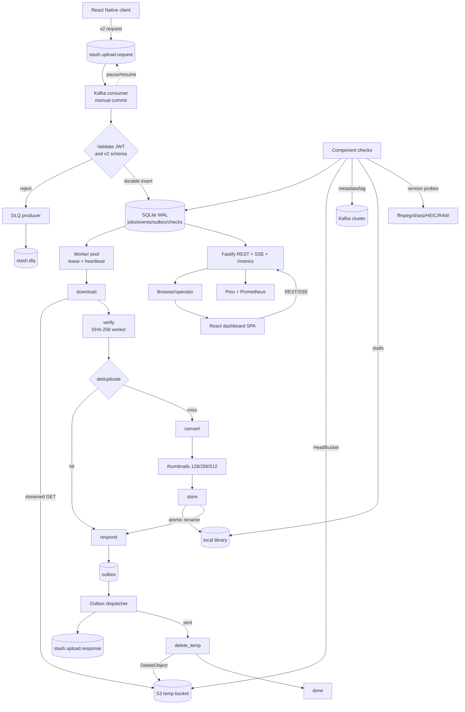
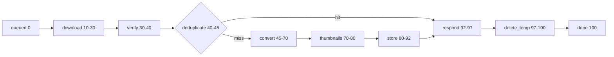

# Stash Host Node - Implementation Plan

Target: `D:\Projects\Stash\Stash\stash_host_node` | Source host: `StashHost.Functions` (legacy, not modified) | Plan date: 2026-11-21.

**Status:** Phases 0-3 complete (plan, scaffold/config/DB, contracts/JWT/ingest, S3/local/media workers, and the durable ten-stage pipeline runner, leases/recovery, worker pool, and pipeline integration tests). Phase 4 (API, SSE, health, metrics, runtime wiring) is in progress. Phases 5-6 are not started. The dashboard UI, Docker packaging, and live Kafka/S3/FFmpeg verification are not implemented. Nothing here claims execution against live Kafka/S3 or device testing.

**Progress tracker:** [IMPLEMENTATION_PROGRESS.md](IMPLEMENTATION_PROGRESS.md) - phase checklists, verification log, and blocked/deferred items.

## 1. Status and scope

| Item | State |
| --- | --- |
| Phase 0 plan | Complete |
| Phase 1 - scaffold/config/DB | Complete |
| Phase 2 - contracts/JWT/ingest/outbox/health | Complete |
| Phase 3 | Complete |
| Phase 4 - API/SSE/metrics | In progress |
| Phases 5-6 | Not started |
| Node app / tests | Created; 105 Vitest tests pass (1 optional MOV case skipped) |
| Old Functions project | Unchanged; legacy/unused after cutover |

The new host is one long-running Node 22 LTS process: Fastify API + static React UI + SSE, Kafka consumer/producer, SQLite WAL durable job queue, leased in-process worker pool, S3 staging download, local permanent library, media pipeline, component health, and Pino/Prometheus observability.

Stack: TypeScript ESM; Fastify 5 + `@fastify/static`/`basic-auth`/`helmet`; `@confluentinc/kafka-javascript`; `better-sqlite3`; `@aws-sdk/client-s3`; `sharp` + `heic-decode`/`libheif-js` + `lightdrift-libraw`; `ffmpeg-static`/`ffprobe-static` + `execa`; `zod` + `jose`; `pino` + `prom-client`; React/Vite/Mantine/`@xyflow/react`/Recharts/TanStack Query/React Router; Vitest.

**Non-goals:** do not modify the old Functions project or change the auth contract (HS256, `stash-auth`/`stash-app`, shared key and claims); do not redesign the RN client; do not change the v1 response wire contract; no multipart/resumable upload or >500 MB support; no multi-node clustering or managed DB in phases 1-6; no live-provider claims without executed tests.

## 2. Current-to-new mapping

| Current | New | Notes |
| --- | --- | --- |
| `KafkaTriggerFunction` batched trigger | `src/kafka/consumer.ts` | Manual commit after durable insert; DLQ publish before commit for rejects. |
| Durable instance id = `correlationId` | `jobs.correlation_id UNIQUE` + `INSERT OR IGNORE` | Duplicate delivery returns the existing job and commits. |
| `FileProcessingOrchestration` | `pipeline/runner.ts` + `stages/*` | Persisted stage, progress, attempts, lease instead of replay. |
| `DownloadFileActivity` + MEGA | `download` + `storage/s3.ts` | Streamed GET to a per-job `.part`; S3 is staging only. |
| `ComputeHashActivity` | `verify` + `workers/hashWorker.ts` | SHA-256 on a worker thread; canonical lowercase hash. |
| `CheckDeduplicationActivity` | `deduplicate` + `storage/local.ts` | Checks final `.jpg`/`.mp4` per user, plus thumbnail presence. |
| `ConvertFormatActivity` + Magick.NET | `convert` + `media/*` | sharp, HEIC worker, LibRaw, FFmpeg. |
| `GenerateThumbnailActivity` fan-out | `thumbnails` | 128/256/512 JPEG, bounded concurrency, center-cropped. |
| `StorePermanentActivity` | `store` | Atomic `.part` -> rename for file and thumbnails. |
| `SendResponseActivity` | `respond` + outbox | Persist before publish; unique `(job_id, kind)`. |
| `DeleteTempFileActivity` | `delete_temp` | S3 DeleteObject; 404 = success; only after send. |
| `DeleteLocalTempActivity` | cleanup + startup sweep | Per-job temp deleted in `finally`. |
| Durable retries/replay | leases/attempts/backoff | Survives restart via SQLite. |
| `HealthCheckFunction` | `/api/health`, `/api/components`, `/metrics` | Real dependency checks. |
| App Insights / ILogger | Pino + Prometheus + SSE | Credential redaction. |
| `host.json` / `local.settings.json` | `config/env.ts` (zod) + `.env.example` | Fail-fast config. |
| `Storage:Provider=Mega` | `S3_*` + `LOCAL_ROOT_PATH` | No MEGA SDK/login. |
| Functions scale controller | in-process pool + Kafka pause/resume | Single node by design. |

## 3. Architecture



1. Decode record, validate v2 schema, key, JWT, claims, identity and correlation.
2. Reject -> DLQ, commit offset, no job/response. Valid -> insert `jobs` in one transaction, then commit.
3. Worker lease advances `queued -> download -> verify -> deduplicate -> convert -> thumbnails -> store -> respond -> delete_temp -> done`.
4. `respond` writes the outbox; dispatcher publishes v1 with acks=all, then triggers deletion. Dedup hits skip convert/thumbnails/store but still respond and delete.
5. Terminal failure sends FAILED through the outbox, records the stage, cleans temp, and applies the guarded deletion policy.

## 4. Runtime topology

One process, one container/host. Fastify binds `127.0.0.1:8080` by default; Kafka group `stash-upload-request`; worker pool 2; hash threads 2; video 1; SQLite WAL on local disk; `LOCAL_ROOT_PATH` mounted volume; S3 and Kafka external. Identity API/Vercel is optional and only issues JWTs; verification is local. The DB must not live on a network share.

Assumptions: exactly one writer per DB/library; the process is non-root with read/write access; S3 credentials come from env/secret storage (currently shared with the client; backend STS is a follow-up); only one host consumes the request topic per environment to avoid double responses.

## 5. Contracts

### 5.1 Version 2 request (`stash.upload.request`, key = `fileId`)

```json
{"messageId":"uuid","timestamp":"2026-11-21T00:00:00.000Z","fileId":"<64 hex>","fileName":"IMG_0001.heic","fileSize":1234567,"mimeType":"image/heic","storageTempPath":"/temp/uploads/<deviceId>/<contentHash>/IMG_0001.heic","storageProvider":"S3","metadata":{"createdAt":"...","modifiedAt":"..."},"deviceId":"<32 hex>","userId":"<id>","correlationId":"uuid","version":2}
```

| Field | Rule |
| --- | --- |
| `version` | Integer, exactly `2`; anything else rejects. |
| `messageId` | Non-empty string, <=128 chars. |
| `timestamp` | Optional ISO-8601; diagnostics only. |
| `fileId` | 64 hex chars, normalized lowercase; becomes canonical after verify. |
| `fileName` | 1-255 chars, no `/`, `\`, control chars, not `.`/`..`; extension/MIME hint only. |
| `fileSize` | Integer `>0` and `<=524288000`; must match streamed bytes and S3 `ContentLength` when present. |
| `mimeType` | `^[a-z0-9][a-z0-9.+-]*/[a-z0-9][a-z0-9.+-]*$`, no whitespace, lowercased. |
| `storageTempPath` | Starts `/temp/`, forward slashes, no backslash/`.`/`..`/empty segments, <=1024; logical path, not a key/URL. |
| `storageProvider` | Case-insensitive `S3` only; others reject explicitly. |
| `metadata` | Optional object, ISO dates, <=64 KB serialized; never used for auth. |
| `deviceId`/`userId` | Optional confirmations; when present must equal JWT claims. |
| `correlationId` | Required, non-empty, <=128, globally unique job identity. |
| Kafka key | Required, must equal `fileId` case-insensitively; canonical lowercase used downstream. |

Validation order: decode -> JSON -> zod -> version/provider -> name/path/size -> JWT -> claims -> payload identity -> header identity -> correlation -> Kafka key -> insert.

JWT: `Authorization` case-insensitive, `Bearer <token>` or bare token for legacy parity; HS256 pinned; the signing key (min 32 chars) is shared with the Identity API/Kafka proxy; `iss=stash-auth`, `aud=stash-app`, `exp` enforced (clock tolerance configurable, default 0). Claims `userId` (fallback `sub`/`nameid`) and `deviceId` (`device_id`) are required; `userId` must match `^[A-Za-z0-9._-]{1,128}$` and not be `.`/`..`. JWT claims are authoritative; payload/header identity is confirmation only, and any mismatch rejects. `X-Correlation-Id`, if present, must match the payload; the merged value is required. Secret/token/presigned values are redacted from logs.

### 5.2 Version 1 response (`stash.upload.response`, key = canonical hash)

| Field | Rule |
| --- | --- |
| `messageId` | New UUID per response; outbox uniqueness is `(job_id, kind)`. |
| `timestamp` | ISO-8601 UTC. |
| `fileId` | Canonical lowercase SHA-256. |
| `status` | Exactly `COMPLETED` or `FAILED` (cancel is FAILED with "Cancelled"). |
| `permanentPath` | Logical `/backups/{userId}/{hash}.jpg|.mp4`; `null` on FAILED. |
| `thumbnails` | Object keys `"128"|"256"|"512"` -> logical `/thumbs/{userId}/{size}/{hash}.jpg`; empty on FAILED. |
| `convertedFormat` | `image/jpeg` or `video/mp4`; best-known value on FAILED. |
| `deduplicated` | `true` only for a full permanent+thumbnail hit. |
| `processingTimeMs` | `finished_at - started_at` (queue wait excluded); `0` if never started. |
| `error` | Short client-safe message; no stack, credentials, or absolute paths. |
| `deviceId`/`userId`/`correlationId` | Echoed from the authenticated job only. |
| `version` | Always `1`. |

### 5.3 DLQ (`stash.dlq`)

Key: original key, else known `fileId`, else empty. Headers: `x-dlq-reason` (code + short text), `x-dlq-kind` (`rejection|processing_failure`), `x-original-topic/partition/offset`, `x-attempts`, `x-failed-stage`, `X-Message-Version: 1`.

- Rejections (`invalid_json`, `invalid_payload`, `unsupported_version`, `invalid_storage_provider`, `jwt_missing`, `jwt_invalid`, `jwt_claim_missing`, `identity_mismatch`, `correlation_missing`, `kafka_key_missing`, `kafka_key_mismatch`): no job, no response; offset commits only after the DLQ publish is acknowledged. Persistent DLQ failure leaves the offset uncommitted, causing retry and visible lag.
- Processing failures after retries: FAILED response still goes out and the job remains visible in the dashboard; `stash.dlq` is reserved for validation/auth/poison rejects. Optional mirroring via `KAFKA_DLQ_MIRROR_FAILURES` is off by default and never conditional on the client response.
- No automatic replay; replay is manual. DLQ poison messages are covered by the S3 lifecycle backstop.

### 5.4 S3 key and local path mapping

Key = logical path without leading slashes, prefixed by trimmed `S3_PREFIX` (the `Storage.S3.Prefix` setting); same normalization as the RN client (forward slashes, no empty/`.`/`..`, no URL-decoding). Examples: `/temp/uploads/dev1/abc/IMG.heic` + prefix `stash` -> `stash/temp/uploads/dev1/abc/IMG.heic`; empty prefix -> `temp/uploads/...`; `/stash/` -> same as `stash`.

`LOCAL_ROOT_PATH` replaces `Storage.Local.RootPath`; example root `D:\StashLibrary`: `/backups/u1/<hash>.jpg` -> `D:\StashLibrary\backups\u1\<hash>.jpg`; `/thumbs/u1/128/<hash>.jpg` -> `D:\StashLibrary\thumbs\u1\128\<hash>.jpg`.

Writer rules: resolve then require the path to start with `path.resolve(LOCAL_ROOT_PATH) + path.sep`; write only `.jpg`/`.mp4` under `backups` and `.jpg` thumbs; validate `userId` as one safe segment and hash as hex; never return absolute paths. Output extension: JPEG/PNG/WebP/AVIF/TIFF/HEIC/HEIF/RAW -> `.jpg`; MOV/MP4 -> `.mp4`; other combinations pass through unchanged (no conversion/thumbnails) with the original extension lowercased.

## 6. Data model

SQLite at `DB_PATH`: `journal_mode=WAL`, `synchronous=NORMAL`, `foreign_keys=ON`, `busy_timeout=5000`, `temp_store=MEMORY`. Ordered migrations run in a transaction and are tracked by `PRAGMA user_version` (v1 in phase 1).

`jobs`: `id` PK; `correlation_id` UNIQUE; `message_id`; `file_id`; `request_file_id`; `file_name`; `file_size`; `downloaded_size`; `mime_type`; `storage_provider`; `storage_temp_path`; `storage_key`; `user_id`; `device_id`; `metadata_json`; `status` (`queued|running|completed|failed|cancelled`); `stage` (`queued|download|verify|deduplicate|convert|thumbnails|store|respond|delete_temp|done`); `failed_stage`; `progress` 0-100; `attempts`; `max_attempts`; `stage_attempts_json`; `next_attempt_at`; `lease_owner`; `lease_expires_at`; `heartbeat_at`; `cancel_requested`; `deduplicated`; `permanent_path`; `thumbnails_json`; `converted_format`; `temp_dir`; `error_code`; `error_message`; `processing_time_ms`; `created_at`; `started_at`; `finished_at`; `updated_at`.

Indexes: `(status, next_attempt_at)`, `(status, stage)`, `(lease_expires_at)`, `(file_id, user_id)`, `(created_at DESC)`, `(finished_at DESC)`, `(user_id, created_at DESC)`, `(device_id, created_at DESC)`.

`job_events`: `id` PK, `job_id` FK, `at`, `level`, `stage`, `event` (`stage_started|stage_completed|retry_scheduled|lease_expired|cancelled|response_sent`), `message`, `data_json`; index `(job_id, id)`, `(at)`; prune older than 30 days or beyond 5,000/job.

`outbox`: `id` PK, `job_id` FK, `kind` default `response`, `topic`, `key`, `payload_json`, `headers_json`, `status` (`pending|sending|sent|failed`), `attempts`, `next_attempt_at`, `created_at`, `sent_at`, `last_error`; `UNIQUE(job_id, kind)`, index `(status, next_attempt_at)`.

`component_checks` (optional phase 4): `id`, `component`, `status` (`ok|degraded|down`), `latency_ms`, `detail`, `checked_at`; index `(component, checked_at DESC)`; 7-day retention.

Transactions: stage transition + event + outbox insert are one `db.transaction`; better-sqlite3 is synchronous/single-writer and no network I/O runs inside a transaction. `progress` is monotonic (`max(prev,new)`); retry/cancel reset rules are explicit; maintenance (`VACUUM`/checkpoint/prune) runs outside job transactions. Terminal states only change via a new operator-triggered run.

## 7. Pipeline stages



| Stage | Progress | Output | Retryable | Terminal / idempotency |
| --- | --- | --- | --- | --- |
| `queued` | 0 | Durable row | n/a | Duplicate correlation returns existing row; no second job. |
| `download` | 10-30 | Temp `.part`, `downloaded_size` | Network/timeout/5xx/429, disk-full after cleanup | 404/403, size mismatch, bad key. Re-run truncates. |
| `verify` | 30-40 | Canonical lowercase hash | Worker crash, transient read | Hash mismatch/empty file. Pure re-run. |
| `deduplicate` | 40-45 | Dedup flag, resolved paths | DB/fs transient | Unreadable/zero-length permanent that cannot repair. Idempotent `stat`. |
| `convert` | 45-70 | `.jpg`/`.mp4` in temp | Decoder crash/OOM with reduced concurrency, FS transient | Unsupported/corrupt input, missing codec. Overwrites output. |
| `thumbnails` | 70-80 | 128/256/512 JPEG in temp | Decoder/OOM/FS transient | Individual sizes may fail; failures are recorded; all-three failure is non-fatal. Overwrites. |
| `store` | 80-92 | Permanent + thumbnails on local volume | I/O, contention, disk-full after cleanup | Path escape/permission/existing mismatch. `.part`+rename, existing identical = success. |
| `respond` | 92-97 | Outbox row -> Kafka response | DB transient (stage) | Publish retries happen in the dispatcher; unique `(job_id,kind)`. |
| `delete_temp` | 97-100 | S3 object removed | 5xx/429/network | 404 = success; persistent failure does not fail a completed job; lifecycle backstop. |
| `done` | 100 | `completed` | n/a | Late duplicates are no-ops. |

Dedup: a full hit requires non-zero permanent plus all three thumbs; missing thumbs are regenerated from the permanent file, then stored. A full hit jumps to 92, sets `deduplicated=true`, and still responds/deletes. Dedup is per user because `userId` is in the path.

Failure/deletion: retryable failures back off with no response; terminal failures send FAILED, clean temp, then delete staging only if no other non-terminal job references the same `storage_key`. Cancellation marks `cancelled`, sends FAILED ("Cancelled"), kills ffmpeg, cleans temp, and uses the same guarded deletion. Success always responds before deleting.

Atomic writes: write `<target>.part-<jobId>-<random>` in the destination directory, fsync, rename; on Windows treat an existing identical-size file as success; commit all three thumbs in `store`; delete `.part` in `finally`; sweep orphaned `.part-*` older than 24h at startup.

## 8. Fault tolerance and large files

**Kafka.** `autoCommit=false`; commit only after the insert transaction commits or the rejection DLQ publish is acknowledged. At-least-once delivery uses `correlation_id` (`INSERT OR IGNORE` + lookup) to dedupe. Producer: `acks=all`, `enable.idempotence=true`, bounded retries. Response key is the canonical hash. The group must have a single active host per environment.

**Leases.** Atomic `UPDATE ... WHERE id=(SELECT ...) RETURNING *` claims queued, due, unleased jobs; SQLite's single writer makes this safe. Lease 120 s, heartbeat 30 s. Recovery claims expired leases, records `lease_expired`, increments the current stage attempt, and requeues or fails terminally. Every stage is re-runnable; respond is protected by outbox uniqueness; delete is idempotent. Graceful shutdown stops claims, waits up to 30 s, kills children, commits only committed DB work, closes the DB.

**Timeouts/retries.** Defaults: download 15 min, verify 5, dedup 30 s, image convert 5, video 60, thumbnails 10, store 10, respond 60 s, delete 60 s. Per-stage max 4 attempts; exponential backoff base 2 s, factor 2, cap 5 min, full jitter. Error classes: `transient`, `resource` (disk/OOM/saturation; longer delay, lower concurrency), `terminal` (no retry). Exhaustion -> FAILED + `job_events` + optional DLQ mirror.

**Outbox/cleanup.** Dispatcher claims due `pending` rows, publishes, marks `sent`, then triggers delete. Publish failure leaves the row pending with backoff; the job stays at respond until send succeeds, so deletion never precedes the response. A response is never published directly by a worker. Lifecycle rule on `temp/` (e.g. 7 days) is the last-resort cleanup.

**Large files.** S3 body is streamed to disk (`pipeline`), never buffered; `HeadObject` checks size first, and the streamed count is checked again. SHA-256 reads 1-4 MB chunks in worker threads. Bounded concurrency: jobs 2, images 2, video 1; a global semaphore limits memory. Disk guard requires `free >= fileSize*3 + 5 GB` before download and again before convert/store; failure is a `resource` retry and pauses claims while cleanup runs. Temp layout `TEMP_DIR/jobs/<id>/`; startup sweeps unreferenced dirs older than 24 h. ffmpeg uses `-progress pipe:1 -nostats`, ffprobe duration, SIGTERM then process-tree kill; sharp runs on libuv, HEIC decode in a dedicated worker; Pino is async. Pause Kafka above 1,000 queued+running, below 5 GB free, or on outbox backlog; resume below 200.

**Recovery cases.**

| Case | Outcome |
| --- | --- |
| Crash after insert, before commit | Redelivery finds the existing correlation; commit. |
| Duplicate while running | No second job; offset committed. |
| Crash mid-download / after convert / after store | Lease expires; stage re-runs idempotently; temp is swept. |
| Crash after outbox insert / after publish / after sent | Pending row publishes later; `(job_id,kind)` + producer idempotence prevent a second logical response; delete resumes. |
| S3 delete 404 | Success. |
| SQLite busy / orphan object | Short transactions + timeout; lifecycle deletes orphans; dashboard shows cleanup-pending. |

## 9. Library research and decisions

| Concern | Choice | Alternatives / rationale |
| --- | --- | --- |
| Kafka | `@confluentinc/kafka-javascript` | librdkafka, actively maintained, prebuilt Windows/Linux, manual commit/pause/resume/admin lag. KafkaJS is effectively unmaintained in 2026; `node-rdkafka` is older. Pin the Node 22 ABI build and test in Docker. |
| S3 | `@aws-sdk/client-s3` v3 | Streaming `GetObject`, `HeadObject`, `DeleteObject`, `HeadBucket`, path-style endpoints. Server-only bundle size is acceptable. |
| SQLite | `better-sqlite3` | Synchronous transactions make claim/stage/outbox atomic; WAL well understood. Queries stay short and never wrap network I/O. `node:sqlite` and `sqlite3` are alternatives but less mature here. |
| Images | `sharp` | Prebuilt libvips; JPEG/PNG/WebP/AVIF/TIFF. **Prebuilt sharp does not decode HEVC-compressed HEIC**, so HEIC/HEIF uses `heic-decode`/`libheif-js` in a worker (RGBA -> sharp). Bound concurrency and pixel limits. |
| RAW | `lightdrift-libraw` -> sharp JPEG | LibRaw prebuilds for Node 22/24 Windows/Linux. Fallbacks: `libraw-wasm` (slower/more memory) or ImageMagick. LibRaw is LGPL-2.1/CDDL; review distribution. |
| Video | `ffmpeg-static`/`ffprobe-static` + `execa` | Predictable binaries, clean cancellation, `-progress` parsing. `ffmpeg-static` bundles a GPL libx264 build; confirm obligations or override `FFMPEG_PATH` with a system LGPL build. |
| Validation/JWT | `zod`, `jose` | One schema for request/env; WebCrypto HS256 with pinned `algorithms`, issuer/audience/clock options. |
| API | Fastify + static/basic-auth/helmet | Good SSE and `inject` testing; same-origin SPA avoids CORS. Express/Hono are alternatives. |
| Observability | `pino`, `prom-client` | Low-overhead redacted logs; Prometheus text is enough for one node; OTel tracing deferred. |
| UI | React/Vite/Mantine/React Flow/Recharts/TanStack Query/Router | Static SPA, live graph, accessible components. Next.js is unnecessary. |
| Testing | Vitest + `inject` + fake ports; optional MinIO/Redpanda | Fast tests without external services; real-protocol tests stay opt-in. |

Licenses: sharp/libvips Apache-2.0; libheif-js LGPL; LibRaw LGPL-2.1/CDDL; FFmpeg static may be GPL. Record pinned-version licenses in `docs/ARCHITECTURE.md` before distribution.

## 10. UI specification

The SPA is built with Vite, served by Fastify from `ui/dist`, and reads a REST snapshot then subscribes to SSE. It never renders secrets, presigned URLs, absolute paths, or tokens.

**Dashboard:** component cards for Kafka consumer, producer/outbox, SQLite, S3, local disk, and media toolchain (`ok|degraded|down`, latency, last check, detail); a React Flow graph with per-stage queued/running/completed/failed counts and active-edge animation; an active-jobs table with progress, elapsed, attempts, last error; throughput (completed/failed per minute, bytes/min) and stage latency (p50/p95) over 15m/1h/24h; recent 10 completions/failures with dedup and timing badges.

**Jobs list:** filter by status, stage, user, device, deduplicated, date; search file name, hash, correlation id, error code; sort newest/oldest/longest/most attempts; cursor pagination (`limit` max 100); polling only while SSE is disconnected; per-job retry/cancel, no bulk actions.

**Job detail:** status/stage/progress, ids, user/device, timestamps; stage timeline from `job_events` with durations, retries, lease recovery; metadata (declared/downloaded size, MIME, logical temp/permanent paths, thumbnails, format, dedup, processing time); attempts and next attempt; filterable logs; retry (terminal only) and cancel (queued/running) with confirmation and API-error display. No SQL or filesystem browse.

**Components:** latest status/latency/error and 24h sparkline per component, check history, consecutive failures, remediation hints ("ffmpeg not found: set FFMPEG_PATH"), and a rate-limited "run check" action; Kafka card shows topic/group/lag when available.

**Logs:** in-memory ring buffer (5,000) plus SSE `log`; filters for level/component/job/correlation/text/time; pause/resume; redaction is server-side.

**SSE:** `GET /api/events` (`text/event-stream`, no-cache, `X-Accel-Buffering: no`, 15 s heartbeat). Events: `snapshot`, `job.updated` (id = `job_events.id`), `component.updated`, `metrics`, `log`. On reconnect, EventSource retries, TanStack Query invalidates and refetches the snapshot, and `Last-Event-ID` replays later `job_events`; periodic metrics/logs are not replayed. Slow clients are dropped to a fresh snapshot. Connections are counted in `stash_sse_clients` and require auth when enabled.

**Auth/binding:** default `127.0.0.1:8080`. Optional HTTP Basic (`DASHBOARD_AUTH_ENABLED/USER/PASSWORD`, min 12) on `/api/*`, `/metrics`, and the SPA; `/api/health` may remain open only on localhost. Exposure beyond localhost requires TLS at a reverse proxy; RBAC is deferred. Helmet CSP is same-origin; CORS is off.

## 11. Phases 1-6

Checkboxes stay unchecked until the phase is implemented and verified.

### Phase 1 - Scaffold, config, DB, types
- [x] `package.json`, TS ESM, `vitest.config.ts`, `tsup.config.ts`, `.env.example`, `.gitignore`. Lint/format tooling is deferred because the task-specified scripts do not include lint.
- [x] `src/config/env.ts` (zod, fail-fast) and `src/logging/logger.ts` (pino redaction).
- [x] Database open + `user_version` migration runner (`src/db/database.ts` and `src/db/migrations.ts`): WAL, foreign keys, busy timeout.
- [x] `jobs`/`job_events`/`outbox` tables and indexes; typed repositories and shared stage/status enums.
- [x] Tests: env parsing, migration idempotency, journal settings.

Files: `package.json`, `tsconfig.json`, `tsup.config.ts`, `vitest.config.ts`, `.env.example`, `.gitignore`, `README.md`, `src/config/env.ts`, `src/logging/logger.ts`, `src/db/**`, `src/contracts/**`, `src/storage/paths.ts`, `test/unit/{config,migrations}.test.ts`.

Accept: fresh DB migrates to v1; re-run is a no-op; invalid env fails with a specific message; typecheck/tests pass.

### Phase 2 - Contracts, JWT, Kafka, enqueue, outbox, health
- [x] v2 zod schema and validator with canonical hash/key equality.
- [x] `jose` HS256 verification, claims, identity/header precedence, redaction-safe errors.
- [x] Consumer with manual commit/pause/shutdown; producer/DLQ with `acks=all`, idempotence, DLQ headers.
- [x] Durable enqueue transaction, duplicate handling, offset ordering; outbox dispatcher skeleton.
- [x] DB/temp health skeleton; fake-consumer tests for valid, duplicate, bad JSON/version/provider/identity.

Files: `src/contracts/{request,response,stages}.ts`, `src/auth/jwt.ts`, `src/validation/requestValidator.ts`, `src/kafka/{producer,consumer,outboxDispatcher}.ts`, `src/pipeline/ingest.ts`, `src/observability/health.ts`, `src/server/index.ts`, `test/unit/{validator,auth,paths,outbox}.test.ts`, `test/integration/ingest.test.ts`.

Accept: exactly one job per unique correlation; rejects reach DLQ before commit; duplicates are no-ops; one outbox publish per job in fake tests.

### Phase 3 - S3, media, workers, leases, recovery
- [x] S3 `HeadObject`/streaming `GetObject`/`DeleteObject`/`HeadBucket`, prefix mapping, typed errors.
- [x] Local writer (path guard, `.part`+fsync+rename, idempotent store), temp manager, disk guard helper (`freeBytes`).
- [x] Hash worker and sharp/HEIC/RAW/FFmpeg/thumbnail modules with progress and cancellation; pool wiring remains for 3B.
- [x] Ten-stage runner, retry classification, leases/heartbeats/recovery, backpressure.
- [x] Phase 3A unit tests: pass-through extension/no-extension paths, traversal, local atomic copy/write/stream/temp cleanup, classify/PNG/WebP conversion/thumbnail sizes/hash, S3 key mapping and typed error classification.
- [x] Phase 3B tests: JPEG pass-through pipeline, PNG conversion, dedup hit/repair, hash mismatch, response-publish failure, lease expiry, and outbox uniqueness. MOV conversion remains skipped because no ffmpeg fixture is guaranteed.

Files: `src/storage/**`, `src/workers/**`, `src/media/**`, `src/pipeline/**`, `test/fakes/fakeS3.ts`, `test/integration/pipeline.test.ts`, `test/fixtures/**`.

Accept: fake-S3 flow produces the file, three thumbs, response and delete; a killed worker recovers; no secrets/absolute paths leak. Real S3/codec tests are reported only if executed.

### Phase 4 - API, SSE, metrics, component checks
- [ ] Fastify factory, helmet/static/Basic auth/error serialiser; routes for health, components, jobs list/detail/events, retry/cancel, stats, logs, metrics.
- [ ] SSE snapshot/replay/heartbeat/eviction; Prometheus metric set; checks for DB, disk, S3, Kafka lag (optional), ffmpeg/ffprobe, sharp, HEIC, RAW.
- [ ] `inject` tests for pagination/filters/404/auth/retry/cancel and SSE framing.

Files: `src/api/**`, `src/observability/{metrics,health,logBuffer}.ts`, `test/integration/{api,sse}.test.ts`.

Accept: stable JSON with no secrets; SSE snapshot + replay; scrape works; missing providers degrade rather than crash.

### Phase 5 - React dashboard
- [ ] Vite app, Mantine, Router, TanStack Query, shared API types.
- [ ] Pages: dashboard (cards, graph, active jobs, charts, recent), jobs, detail, components, logs.
- [ ] SSE hook with snapshot/reconnect/backoff/invalidation; retry/cancel UI; Vite build served by Fastify with SPA fallback.

Files: `ui/package.json`, `ui/src/{main,App}.tsx`, `ui/src/{api,hooks,pages,components}/**`.

Accept: `npm run build:ui` passes; all routes render against a fake API; live updates and auth/empty/error states work; no sensitive data shown.

### Phase 6 - Docker, integration, docs
- [ ] Multi-stage non-root Dockerfile, healthcheck, `.dockerignore`; compose for app + MinIO + Redpanda (optional profile).
- [ ] Optional real S3/Kafka/manual-commit/DLQ tests and opt-in 500 MB streaming test.
- [ ] README, ARCHITECTURE, RUNBOOK; root setup migration note; proxy consumer references; RN host label only after verification.
- [ ] Final `npm run verify`; record commands/results.

Files: `Dockerfile`, `docker-compose.yml`, `README.md`, `docs/{ARCHITECTURE,RUNBOOK}.md`, `test/integration/{minio,redpanda}.test.ts`, root docs listed in section 16.

Accept: image builds/starts with mounted volume/env; compose integration passes when run; docs contain no unverified claims; old Functions untouched.

## 12. Progress tracker

| Phase | Status | Started | Completed | Verification | Notes |
| --- | --- | --- | --- | --- | --- |
| 0 - Plan | Complete | 2026-11-21 | 2026-11-21 | Reviewed against legacy host and RN v2 contract | This document only |
| 1 - Scaffold/config/DB | Complete | 2026-11-21 | 2026-11-21 | `npm run typecheck` pass; `npm test` pass (69 tests); `npm run build` pass; dev server `/health/live` and `/api/health` smoke-tested | Files use `database.ts`/`migrations.ts` (no `connection.ts`/`001_init.sql`) per task spec |
| 2 - Contracts/Kafka/enqueue | Complete | 2026-11-21 | 2026-11-21 | `npm run typecheck` pass; `npm test` pass (69 tests); validator/JWT/ingest/outbox tests use fake DLQ only | Kafka/S3 not started by the server; no live broker or bucket contacted |
| 3 - S3/media/workers | Complete | 2026-11-21 | 2026-11-21 | `npm run typecheck` pass; `npm test` pass (11 files, 105 passed + 1 skipped; 8 pipeline integration cases pass, MOV skipped); `npm run build` pass | Phase 3A storage/local/media/workers and Phase 3B runner/pool/leases/recovery/temp cleanup implemented; response outbox, finalization staging, retries, and guarded S3 deletion are covered by fake-provider tests |
| 4 - API/SSE/metrics | In progress | 2026-11-21 | - | In progress: inject + SSE tests | API/SSE/health/metrics/runtime wiring underway; see IMPLEMENTATION_PROGRESS.md |
| 5 - React UI | Not started | - | - | Planned: UI build + fake-API browser check | No code |
| 6 - Docker/integration/docs | Not started | - | - | Planned: compose/integration + final verify | No code |

### Verification log (2026-11-21)

| Command | Result |
| --- | --- |
| `npm run typecheck` | Pass (strict TypeScript, no errors) |
| `npm test` | Pass (7 files, 69 tests) |
| `npm run build` | Pass (`dist/server/index.js`) |
| `npm start` smoke | Pass; built server returned `/health/live` ok |
| `npm run dev` smoke | Pass; `GET /health/live` returned `ok` and `GET /api/health` returned DB/temp/config `ok` with S3/Kafka `unknown` stubs |
| `npm install` | Runtime and dev dependencies installed; `better-sqlite3`, `sharp`, `@confluentinc/kafka-javascript`, `ffmpeg-static`, and `lightdrift-libraw` load locally |

No live Kafka, S3, successful media conversion, or UI verification was performed in Phases 0-2.

### Verification log (2026-11-21, Phase 3A)

| Command | Result |
| --- | --- |
| `npm run typecheck` | Pass (strict TypeScript, no errors; includes new storage/media/worker modules and tests) |
| `npm test` | Pass (10 files, 97 tests) |
| `npm run build` | Pass; emits `dist/server/index.js`, `dist/server/workers/hash.worker.js`, `dist/server/workers/media.worker.js` |
| Hash worker dev smoke | Pass; `runHashWorker` via `tsx` returned the known SHA-256 for `hello` |
| Built worker smoke | Pass; both built worker files start and respond (hash progress; media worker rejects an invalid task) |
| FFmpeg failure path | Exercised with an invalid video fixture; thumbnails degraded to failures without crashing. No successful video conversion was exercised. |
| S3/Kafka live | Not exercised; S3 key mapping and typed errors were tested with an injected fake client. |

### Verification log (2026-11-21, Phase 3B)

| Command | Result |
| --- | --- |
| `npm run typecheck` | Pass (strict TypeScript, no errors; includes pipeline runner/stages, retry/timeout helpers, response builder, outbox `flushJob`, worker pool, temp cleanup, and integration tests) |
| `npm test` | Pass (11 files, 105 tests passed, 1 skipped). The new `test/integration/pipeline.test.ts` contributes 8 passing cases (JPEG success with COMPLETED response and S3 delete; PNG-to-JPEG conversion; dedup hit without permanent overwrite; hash mismatch FAILED response plus guarded delete; dead response outbox with S3 retained; lease requeue; exhausted-lease finalization; outbox uniqueness/idempotent flush). The MOV case is skipped because no ffmpeg fixture is guaranteed. |
| `npm run build` | Pass; emits `dist/server/index.js`, `dist/server/workers/hash.worker.js`, and `dist/server/workers/media.worker.js` |
| Pipeline provider scope | Real SQLite, real `LocalLibrary`, real `OutboxRepository`/`OutboxDispatcher`, and SHA-256 hashing were exercised; S3 and the Kafka publisher were fakes. |
| Live S3/Kafka/FFmpeg | Not exercised in Phase 3B; no live broker, bucket, or successful video conversion is claimed. |

Phase 3 is complete for the fake-provider pipeline scope. The worker pool is implemented but not yet started by the server entry point; API/SSE wiring remains Phase 4.

## 13. Environment variables

Validated by zod at startup. `.env.example` holds placeholders; `.env` is gitignored. Secrets come from env/secret storage.

```text
NODE_ENV=development                  # development|test|production (pretty logs only in dev)
HOST=127.0.0.1                        # bind address; 0.0.0.0 only behind a trusted proxy
PORT=8080                             # Fastify port
DASHBOARD_AUTH_ENABLED=false          # enable HTTP Basic on API/UI/metrics
DASHBOARD_USER=                       # required when auth is enabled
DASHBOARD_PASSWORD=                   # required when auth is enabled, min 12 chars
LOG_LEVEL=info                        # fatal|error|warn|info|debug|trace
SHUTDOWN_GRACE_SECONDS=30             # graceful shutdown window
SSE_HEARTBEAT_MS=15000                # SSE keep-alive
LOG_BUFFER_SIZE=5000                  # in-memory log entries
```

```text
KAFKA_BROKERS=                        # required, comma-separated
KAFKA_CLIENT_ID=stash-host-node
KAFKA_GROUP_ID=stash-upload-request
KAFKA_REQUEST_TOPIC=stash.upload.request
KAFKA_RESPONSE_TOPIC=stash.upload.response
KAFKA_DLQ_TOPIC=stash.dlq
KAFKA_SECURITY_PROTOCOL=SASL_SSL      # PLAINTEXT|SSL|SASL_PLAINTEXT|SASL_SSL
KAFKA_SASL_MECHANISM=SCRAM-SHA-256
KAFKA_USERNAME=                       # SASL username
KAFKA_PASSWORD=                       # SASL password
KAFKA_PAUSE_HIGH_WATERMARK=1000       # pause above queued+running
KAFKA_RESUME_LOW_WATERMARK=200        # resume below
KAFKA_DLQ_MIRROR_FAILURES=false       # mirror terminal failures after FAILED response; off by default
KAFKA_COMMIT_TIMEOUT_MS=10000
```

```text
S3_BUCKET=                            # required staging bucket
S3_REGION=                            # required
S3_ENDPOINT=                          # MinIO/custom endpoint, http(s)://
S3_FORCE_PATH_STYLE=false
S3_ACCESS_KEY_ID=                     # required
S3_SECRET_ACCESS_KEY=                 # required
S3_SESSION_TOKEN=                     # optional
S3_PREFIX=                            # must match the RN client prefix
S3_REQUEST_TIMEOUT_MS=300000
JWT_SIGNING_KEY=                      # required shared HS256 key, min 32 chars
JWT_ISSUER=stash-auth
JWT_AUDIENCE=stash-app
JWT_CLOCK_TOLERANCE_SECONDS=0
```

```text
LOCAL_ROOT_PATH=                      # required permanent library root (local disk/volume)
TEMP_DIR=                             # default <os tmp>/stash-host-node
DB_PATH=./data/stash_host.db          # must be local disk, not a network share
WORKER_CONCURRENCY=2                  # concurrent jobs
WORKER_HASH_THREADS=2                 # SHA-256 worker threads
IMAGE_CONCURRENCY=2                   # sharp/decode concurrency
VIDEO_CONCURRENCY=1                   # ffmpeg concurrency
JOB_MAX_ATTEMPTS=4                    # per-stage attempt cap
LEASE_SECONDS=120
HASH_WORKER_TIMEOUT_MS=300000
MEDIA_WORKER_TIMEOUT_MS=600000
HEARTBEAT_SECONDS=30
RECOVERY_INTERVAL_SECONDS=30
DISK_MIN_FREE_BYTES=5368709120        # 5 GB floor on top of the 3x file estimate
TEMP_RETENTION_HOURS=24
STAGE_TIMEOUT_DOWNLOAD_MS=900000
STAGE_TIMEOUT_VERIFY_MS=300000
STAGE_TIMEOUT_CONVERT_IMAGE_MS=300000
STAGE_TIMEOUT_CONVERT_VIDEO_MS=3600000
STAGE_TIMEOUT_THUMBNAILS_MS=600000
STAGE_TIMEOUT_STORE_MS=600000
STAGE_TIMEOUT_RESPOND_MS=60000
STAGE_TIMEOUT_DELETE_MS=60000
RETRY_BASE_MS=2000
RETRY_MAX_MS=300000
DELETE_TEMP_ON_FAILURE=true           # guarded shared-key deletion policy
```

```text
FFMPEG_PATH=                          # default from ffmpeg-static
FFPROBE_PATH=                         # default from ffprobe-static
FFMPEG_VIDEO_CODEC=libx264            # non-x264 uses -q:v 5
FFMPEG_CRF=23
FFMPEG_PRESET=fast
THUMBNAIL_QUALITY=90
IMAGE_JPEG_QUALITY=90
MAX_IMAGE_PIXELS=200000000            # decompression-bomb guard
HEIC_WORKER_ENABLED=true
RAW_DECODER=libraw                    # libraw|wasm|imagemagick
METRICS_ENABLED=true
COMPONENT_CHECK_INTERVAL_SECONDS=60
```

## 14. Verification plan

Run from `stash_host_node`; record commands, dates, and output summaries. Do not claim an unexecuted check.

| Check | Planned command | Proves |
| --- | --- | --- |
| Install | `npm ci` | Lockfile resolves on the target OS. |
| Typecheck | `npm run typecheck` | No TS errors. |
| Lint | `npm run lint` | Style/defects. |
| Unit | `npm test` | Env, paths, validator, progress, retry, migrations. |
| API | `npm run test:api` | Routes, auth, pagination, error shapes. |
| Fake pipeline | `npm run test:pipeline` | Full stages with fake S3/local root and fixtures. |
| UI build | `npm run build:ui` | Vite production build is servable. |
| Full | `npm run verify` | Typecheck + lint + unit + API + pipeline + UI build. |
| MinIO (optional) | `docker compose --profile integration up -d minio` + `npm run test:integration:s3` | Real HEAD/stream/GET/DELETE and prefix mapping. |
| Redpanda (optional) | `docker compose --profile integration up -d redpanda` + `npm run test:integration:kafka` | Real produce/consume, manual commit, duplicate, DLQ headers. |
| Large file (opt-in) | `npm run test:large` | 500 MB streams without buffering; RSS bounded; hash matches. |
| Container smoke | `docker build` + run with temp volume | Startup, health, config validation. |
| UI smoke | `npm run dev` with fake API | Pages, live SSE, reconnect. |

Codec results are per platform/fixture; unavailable prebuilds or fixtures are reported "not exercised", not "supported". Fake-pipeline success is never reported as end-to-end. The old Functions tests are not evidence for the new host.

## 15. Risks and deferred work

| Risk | Mitigation / deferral |
| --- | --- |
| HEIC/HEVC decode coverage | Dedicated `heic-decode`/`libheif-js` worker, fixtures, capability check, `HEIC_WORKER_ENABLED`, dashboard failures; patent/licensing review. |
| RAW prebuild availability | Pin `lightdrift-libraw`; fallback `libraw-wasm`/ImageMagick; startup probe; LGPL/CDDL review. |
| FFmpeg availability/licensing | Static binary + `FFMPEG_PATH` override + version probe; confirm GPL/libx264 obligations before distribution. |
| Single-node SQLite | Explicit one-writer assumption, WAL, short transactions, busy timeout; multi-node deferred. |
| Dashboard Basic auth only | Localhost default, opt-in Basic, TLS reverse proxy if exposed; RBAC deferred. |
| Shared S3 credentials | Env/secret storage, least-privilege bucket policy, no presigned URL logging; backend STS is a separate follow-up. |
| Orphaned staging objects | Delete after response, shared-key guard, lifecycle rule, cleanup-pending dashboard state. |
| Memory/disk pressure | Streaming, worker-thread hashing, bounded concurrency, 3x disk guard, sweeps, opt-in large test. |
| Duplicate responses | Idempotent producer, unique outbox key, client matches by ids. |
| Two hosts during cutover | Runbook: stop old consumer, drain, start Node; one group owner per environment. |
| Video progress accuracy | ffprobe duration + `-progress`; indeterminate state when duration is unknown. |
| Unsupported input semantics | Unsupported types pass through unchanged: stored as-is with the original MIME, extension lowercased, conversion and thumbnails skipped. Remaining risk: unsafe/unsupported MIME is stored as-is and the dashboard flags no thumbnails. |
| Legacy code rot | Freeze Functions, document cutover, remove only in a later explicit task. |

Deferred: multi-node workers, backend STS/presigned issuance, multipart/resumable upload, proxy ACK/inbox, dashboard RBAC, distributed tracing, automatic DLQ replay.

## 16. Documentation targets

| Target | Change |
| --- | --- |
| `stash_host_node/README.md` | New: purpose, prerequisites, install, env, run, dashboard, tests, troubleshooting. |
| `stash_host_node/docs/ARCHITECTURE.md` | New: topology, stages, data model, contracts, codec decisions, licenses. |
| `stash_host_node/docs/RUNBOOK.md` | New: start/stop, cutover, outages, lease recovery, disk cleanup, DLQ inspection, DB/library backup. |
| `docs/LOCAL_FULL_STACK_SETUP.md` (root) | Migration note: Node host is the processing host; legacy Functions reference only; env/topics/bucket/prefix and verification. |
| `kafka_proxy_vercel/README.md` | Point response-consumer references at the Node host; no proxy code change expected. |
| RN `docs/ARCHITECTURE.md` / `docs/SETUP_AND_USAGE.md` | Update host label/gap only after v2 + S3 are verified; otherwise keep the documented gap. |
| `StashHost.Functions/*` | No changes. |

## 17. Confirmed decisions

1. **Unsupported inputs:** pass through unchanged (legacy behavior). Store the original extension lowercased, skip conversion, skip thumbnails, and report the original MIME as `convertedFormat`. Never store without path/size/MIME/hash validation.
2. **Thumbnail failure:** degrade to the sizes that succeed. Record missing sizes in job events and `thumbnails` only includes successful paths. All-three failure is non-fatal, but the job remains visible as degraded if no thumbnails were produced.
3. **Terminal-failure deletion:** delete S3 staging after the FAILED response is acknowledged, guarded by a shared-storage-key reference check; keep it during retries and on outbox exhaustion (lifecycle rule is the backstop).
4. **DLQ mirroring:** reserve `stash.dlq` for validation/auth/poison rejects. Terminal processing failures send FAILED responses and remain visible in the dashboard; optional `KAFKA_DLQ_MIRROR_FAILURES=false` is off by default.
5. **`processingTimeMs`:** first worker claim (`started_at`), so queue wait is excluded.
6. **Consumer API:** manual-commit `eachMessage` with `autoCommit=false`; commit only after the durable insert transaction or acknowledged DLQ publish.
7. **Dashboard exposure:** bind `127.0.0.1` by default; optional HTTP Basic on API/UI/metrics; TLS at a reverse proxy if exposed.
8. **Dedup repair:** regenerate missing thumbnails from the existing permanent file; if repair fails, return the available paths and keep `deduplicated=true`.
9. **Cancellation:** report FAILED with error `Cancelled` because the v1 response contract has only COMPLETED/FAILED.
10. **Placement:** app root is `D:\Projects\Stash\Stash\stash_host_node`, a sibling of `StashHost.Functions`.


